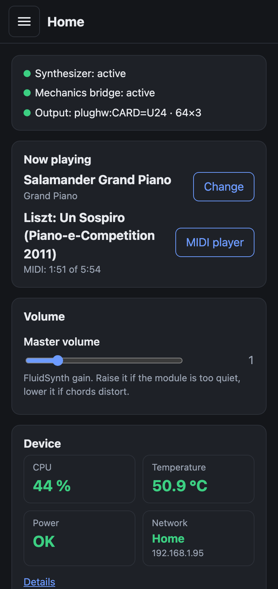
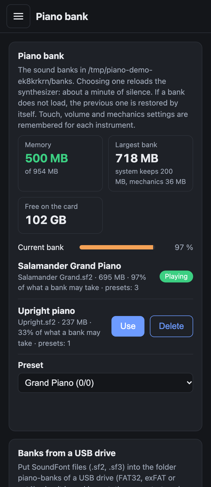
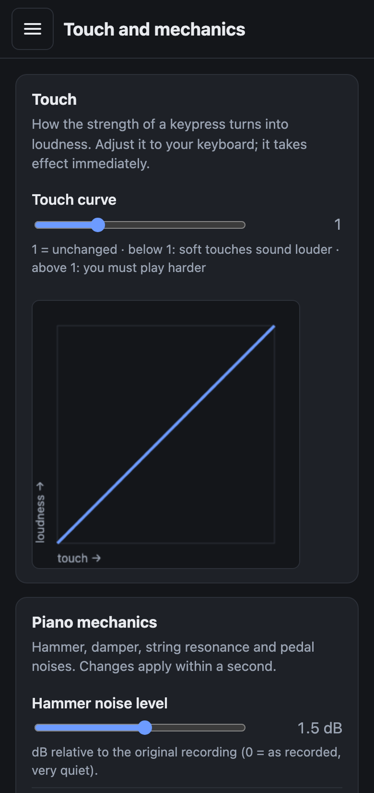
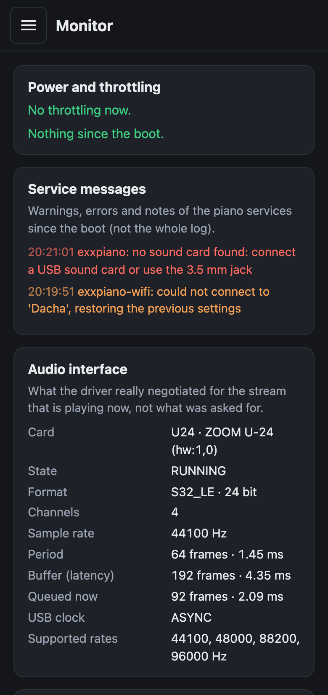
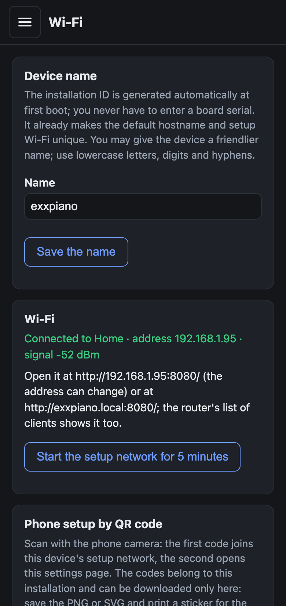
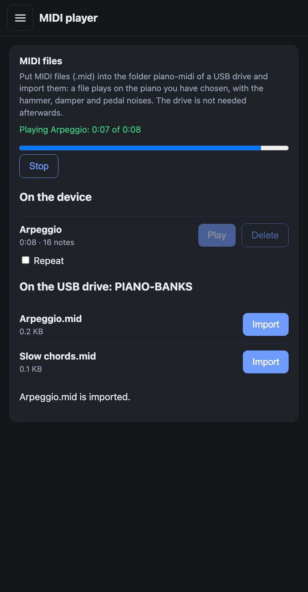

# exxpiano

English | [Русский](README.ru.md)


[](https://github.com/exxbrain/exxpiano/actions/workflows/build.yml)
[](https://github.com/exxbrain/exxpiano/actions/workflows/release.yml)
[](https://github.com/exxbrain/exxpiano/releases/latest)

**A good piano sound on a cheap board, with the least effort.** exxpiano turns a Raspberry Pi into a digital piano for any USB MIDI keyboard: write an image to a card, power the board on, set everything up from a phone. No installation, no screen on the board. From writing the card to the first sound takes a few minutes (not a timed measurement).

> **Made for boards with 1 GB of memory.** The full grand piano bank (about 700 MB, the one in the videos below) is built to fit a 1 GB board such as the Raspberry Pi 3 Model B, and that is the board it was tuned and tested on. A 512 MB board (Pi 3 A+) also plays, with the smaller `lite` bank.
>
> **No computer needed to play.** Once the card is written, the piano is a device on its own: plug in the keyboard and the headphones, power it on and play. The piano starts by itself; the phone is only for changing settings, and the computer only for writing the card.

## Start in 4 steps (nothing to build)

You need a Raspberry Pi 2, 3 or 4, a microSD card, a **5.1 V / 2.5 A** power supply, a USB MIDI keyboard, and headphones or speakers.

1. **Download** the ZIP for your board from [the latest release](https://github.com/exxbrain/exxpiano/releases/latest): `exxpiano-rpi234-…-sd.zip` for a Pi 2/3/4 (`exxpiano-rpi5-…-sd.zip` for a Pi 5: not yet tried on a real Pi 5, and it needs a USB sound card).
2. **Write it to the microSD card** with [Raspberry Pi Imager](https://www.raspberrypi.com/software/): *Choose OS* → *Use custom* → the ZIP as it is (do not unzip it).
3. **Switch it on:** put the card into the Pi, plug in the keyboard and the headphones (3.5 mm jack or a USB sound card) and power it on. The first start is offline and may take several minutes.
4. **Open it from your phone:** join the Wi-Fi network **`exxpiano-Setup-<ID>`** (password **`exxpianosetup`**); the web interface opens by itself or at `http://10.42.0.1:8080/`. In its **Wi-Fi** section connect the Pi to your home network, then open `http://exxpiano-<id>.local:8080/`. With an Ethernet cable there is no setup network: open that address directly.

Then play. Details: "Connecting to a new Wi-Fi", "Power supply" and "Audio output and latency" below. "Deployment in short", "Quick start" and "SD card image" are only for building the banks and the image yourself.

## What it can do

- **Real piano sound:** SoundFont banks through FluidSynth, plus the piano mechanics (hammer and damper noise, string resonance, pedal noise) that the SF2 format cannot express by itself. The ready images carry the Salamander Grand Piano V3 (Yamaha C5); any other `.sf2` / `.sf3` bank can be added from a USB drive and chosen in the web interface, and every bank remembers its own touch and mechanics settings.
- **Made for 1 GB boards:** the `full` bank (about 700 MB) is built for a board with 1 GB; a 512 MB board gets the smaller `lite` bank. The image picks the bank by itself.
- **A ready image:** one ZIP for the Raspberry Pi 2/3/4 and one for the Pi 5; the first start is offline and asks for nothing. The Pi 5 has no 3.5 mm jack and plays through a USB sound card.
- **Automatic choices:** any USB MIDI keyboard is found by itself; the sound goes through a USB sound card (small delay) when there is one, else through the 3.5 mm jack.
- **Setup from a phone:** a web interface for the touch curve, the mechanics, volume, banks, audio output, Wi-Fi (through the device's own setup network and a QR code) and monitoring (processor, temperature, power, memory, errors).
- **From a USB drive:** import sound banks and play MIDI files on the chosen piano, with the mechanics.
- **Open and tested:** open source (scripts MIT, sounds CC-BY, the two demonstration recordings CC BY-NC-SA) with hundreds of automatic tests; what was not tried on a real board is marked as such.

Not yet tried on real hardware: the Pi 5 image, the import from a USB drive (see "Tested on" below).

## What it looks like

| Home | Piano bank (and the USB import) | Touch and mechanics |
|---|---|---|
|  |  |  |

| Monitor | Wi-Fi | MIDI player |
|---|---|---|
|  |  |  |

*The pictures are made by `scripts/make-screenshots.py` from the demo `scripts/demo-web.py` (a simulated device: the numbers, the networks and the banks are made up; the pieces are the real recordings of `assets/midi/`), at the width of a phone.*

## What it sounds like

<table>
<tr><th width="50%">Full bank</th><th width="50%">Lite bank</th></tr>
<tr><th colspan="2"><i>La Campanella</i> (from 1:48)</th></tr>
<tr>
<td><video src="https://github.com/user-attachments/assets/5af2d54a-346b-4e7b-b226-b4280eef114d" controls width="100%"></video><br><a href="https://github.com/exxbrain/exxpiano/releases/download/demo-videos/exxpiano-la-campanella-full.mp4">1080p</a></td>
<td><video src="https://github.com/user-attachments/assets/c361e8f3-9bf6-4876-bbb2-815873b3b06a" controls width="100%"></video><br><a href="https://github.com/exxbrain/exxpiano/releases/download/demo-videos/exxpiano-la-campanella-lite.mp4">1080p</a></td>
</tr>
<tr><th colspan="2"><i>Un Sospiro</i></th></tr>
<tr>
<td><video src="https://github.com/user-attachments/assets/c7ed836e-0145-4758-84f3-e3ed269441a2" controls width="100%"></video><br><a href="https://github.com/exxbrain/exxpiano/releases/download/demo-videos/exxpiano-un-sospiro-full.mp4">1080p</a></td>
<td><video src="https://github.com/user-attachments/assets/7e61fa66-f521-474f-8c34-18ba92c9312f" controls width="100%"></video><br><a href="https://github.com/exxbrain/exxpiano/releases/download/demo-videos/exxpiano-un-sospiro-lite.mp4">1080p</a></td>
</tr>
</table>

*The two pieces that come with the device, played by its MIDI player on a Raspberry Pi 3 Model B running exxpiano 1.10.21 and recorded from the device: the `full` bank on the left, the `lite` bank on the right, both with the mechanics and 256 voices. Nothing was added to the sound but one gain per recording to bring them all to the same level. The falling notes are drawn from the same MIDI files. The performances are from the MAESTRO dataset and, like these videos, are **CC BY-NC-SA 4.0** (see "Licenses").*

## How it works

A digital piano appliance for Raspberry Pi 2/3/4/5 (ARMv8): SoundFont banks through FluidSynth (the ready images carry **Salamander Grand Piano V3**, Yamaha C5; the mechanics are tuned on it, so with another bank the levels may need adjusting in the web interface), plus
**piano mechanics** - hammer and damper noise, string resonance, pedal noise - which the SF2 format cannot
express by itself, so a small bridge program adds them.

```
USB MIDI keyboard ─► exxpiano-fx.py ─► FluidSynth ─► audio output
                        │             ├─ piano.sf2  (the piano, channel 0)
                        └─ mechanics ─►└─ mech.sf2   (channels 1-6)
```

Everything starts by itself when the Pi powers on, and keyboards connect automatically: the bridge rescans the MIDI
ports every 2 seconds. Connecting a keyboard while the Pi is running is supported by design, but only connecting at boot
was tested on a Pi.

**The keyboard is chosen automatically, no pairing or setup.** The bridge looks at the MIDI ports every 2 seconds and takes every hardware MIDI input except service ports (Through, Timer, Announce, FLUID and the like), so any class-compliant USB keyboard works as soon as it is plugged in, several keyboards can play at once, and the bridge reconnects by itself when the synthesizer restarts. Connecting at boot was tested on a Pi with an Arturia KeyLab Essential 49 mk3; plugging in while the Pi runs is built in but not tested.

**The sound output is chosen automatically, to keep the delay low.** If an external USB sound card or audio interface is plugged in, exxpiano plays through it with a very small buffer (64 frames x 3, about 4.4 ms of buffering plus the delay of the interface itself); without one it falls back to the 3.5 mm jack of the board, where the driver raises the buffer to 444 frames (about 30 ms by calculation). The choice is made when the service starts, the buffers are remembered per interface. The delay was not measured end to end; a Zoom U-24 played without clicks on a Pi 3.

## Tested on

- Raspberry Pi 3 Model B (1 GB; a 512 MB Pi 3 A+ needs the smaller `lite` bank, see below), DietPi (Debian, FluidSynth 2.4.4), Arturia KeyLab Essential 49 mk3 keyboard,
  onboard 3.5 mm output;
- building the banks: macOS (Apple Silicon), FluidSynth 2.6.1, ffmpeg.

Other boards, keyboards and sound cards were not tested. I recommend a USB sound card (see "Audio output and latency"),
but this setup was not measured with one.

## What you need

| | |
|---|---|
| A Raspberry Pi 2, 3 or 4 supported by the DietPi RPi234 ARMv8 image | an SD card containing the product image |
| **A 5.1 V / 2.5 A power supply and a short cable** | see "Power supply" - this is not a formality |
| A USB MIDI keyboard | class-compliant, no drivers needed |
| Only to build it yourself: a Mac or Linux machine for the banks | `python3`, `ffmpeg` (with `ffprobe`), `curl`, `tar` with xz; ~2 GB of free space |

## Deployment in short

The shipped product is a ready device with exxpiano already installed. One complete DietPi image is reusable across compatible Raspberry Pi 2/3/4 boards; a separate package or installer bundle is not a delivery format.

1. Build the banks once: `scripts/make-soundfonts.sh -p full` and `-p lite` (the second reuses the samples downloaded by the first). This creates the required `build/piano-full.sf2` and `build/mech.sf2` and the smaller `build/piano-lite.sf2` for boards with 512 MB.
2. Build the reusable image with `scripts/build-sd-image.py --dietpi <DietPi_RPi234-ARMv8...img.xz>`.
3. Flash `exxpiano-rpi234-v<VERSION>-dietpi-<DIETPI_VERSION>-sd.zip` directly to a clean SD card with Raspberry Pi Imager or balenaEtcher.
4. Insert the card into a compatible Raspberry Pi 2, 3 or 4 and power it on.

See [the image-building guide](docs/BUILD-IMAGE.md) for the complete procedure and current verification status.
Version tags named `v<VERSION>` build this image and publish it together with its manifest, README, and checksums as assets of a GitHub Release.

## Quick start (building it yourself)

### 1. Build the sound banks (on a Mac/Linux)

The banks themselves are not stored in the repository (hundreds of megabytes, and Salamander's license is CC-BY, see
[NOTICE.md](NOTICE.md)). A script makes them from the original archive:

```bash
scripts/make-soundfonts.sh -p full -o build          # downloads ~412 MB and builds
```

If you already have Salamander unpacked (a folder with `SalamanderGrandPianoV3Retuned.sfz`), point to it: `-s /path/to/folder`.

Result: `build/mech.sf2` (36 MB) and `build/piano-<preset>.sf2`.

#### Choosing the sample package (`-v`)

Salamander is published by [FreePats](https://freepats.zenvoid.org/Piano/acoustic-grand-piano.html) in several packages. The builders
find the sample files through the paths written in the SFZ, and convert everything to 44.1 kHz / 16 bit, so the
resulting banks have the same size whichever package you take; the source only changes how faithful the conversion is
and how much you download.

```bash
scripts/make-soundfonts.sh -p full -v 48k24 -o build     # take the 48 kHz / 24 bit WAV package
```

| `-v` | Package | Download | Status |
|---|---|---|---|
| `44k16` (default) | SFZ WAV, 44.1 kHz 16 bit | 412 MB | built and used on a real Pi |
| `48k24` | SFZ WAV, 48 kHz 24 bit | 1.26 GB | checked on a copy of the `44k16` set converted to this format (the rendered audio matches the `44k16` build, difference 67 dB below the signal); the real 1.26 GB download was **not** tried |
| `48k24-flac` | SFZ FLAC, 48 kHz 24 bit (2020-06-02 package) | 742 MB | **experimental**: the code path (FLAC, other folders) is tested on a synthetic set, but the real archive's layout and SFZ file name were not inspected; if the SFZ is not found, pass `-n NAME` |

For any other Salamander SFZ package use `-u URL` (and `-n NAME` if its SFZ file is named differently). The layer
table in the builder assumes the 16 velocity layers of the V3 set. FreePats also offers a ready-made SF2 of Salamander;
it is not used here because it has no mechanics presets and no layer reduction.

| Preset | Memory on the Pi | What it is | `GAIN` | Tested on a Pi 3 |
|---|---|---|---|---|
| `lite` | ~250 MB | 6 layers, stereo, 9 s tails | 0.6 | a close variant (CPU load ~30%) |
| `full` | ~700 MB | 14 layers, stereo, 12 s tails; for a board with 1 GB (the memory reserve for such boards is 200 MB). **Not for 512 MB** | 0.6 | starts and plays on a board with 1 GB; by ear it sounds better than the earlier 390 MB bank and significantly better than the ready-made light Salamander SoundFont of the official library (one listener, not a blind test); the free memory after loading was not recorded, watch `free -m` |

The whole file is read into RAM. A Pi 3 Model B/B+ has 1 GB; a **Pi 3 Model A+ has only 512 MB (about 414 MB usable)**, and `full` does not fit there:
on a real Pi 3 A+ the kernel killed FluidSynth with a 390 MB bank at about 370 MB (`Out of memory: Killed process (fluidsynth)`) and the service restarted again and again. Use `lite`
(237 MB; **played on a real Pi 3 A+, it works**, including the automatic choice at the first start). `lite` against `full`: 6 velocity layers
instead of 14, tails of 9 s instead of 12 s, and the softest note is louder (−12 dB instead of −17 dB), so the dynamic range is somewhat smaller. Check the free memory yourself (`free -m`, the `available` column).

### The Salamander limit and how exxpiano works around it

Salamander Grand Piano V3 is recorded for a computer: 16 velocity layers on every note, long tails, separate mechanics recordings. The compressed download is 412 MB, the unpacked recordings are noticeably larger, and FluidSynth reads a bank into RAM whole. The full set does not suit a cheap board with 512 MB or 1 GB.

So exxpiano does not try to load the original. It builds **reduced SF2 banks** from it: it keeps some of the layers (14 of 16 in `full`, 6 in `lite`), trims the tails with a smooth fade, levels the layers and adds a gentle dependence of volume on touch. The mechanics (hammers, dampers, resonance, pedal) live in a separate small bank, because SF2 cannot express the SFZ rules. The result:

- on a board with **1 GB** `full` (about 700 MB) plays; by ear it sounds better than the earlier 390 MB bank and significantly better than the ready-made light Salamander SoundFont of the official library;
- on the **cheapest Pi 3 A+ with 512 MB** `lite` (about 237 MB) plays, tested on a real board.

The price: fewer velocity layers and shorter tails than the original; `lite` has louder soft notes and a slightly narrower dynamic range. How audible this is has been judged by ear, not measured. `full` was compared by ear with the ready-made light Salamander SoundFont of the official library and sounds significantly better; `full` has not been compared with the original, and our `lite` has not been compared with `full` or with that SoundFont. We have no comparison of the original against the exxpiano banks.

## Comparison with alternatives

This comparison comes from project descriptions and reviews, not from my own measurements: I did not measure the sound, latency or resource use of the others. Prices change, check the current ones on the vendors' sites.

| | exxpiano | Pianoteq on a Raspberry Pi | Zynthian | A hand-made FluidSynth on a Pi (FluidPi, PiPiano and the like) |
|---|---|---|---|---|
| Sound | samples of Salamander Grand Piano V3 (CC-BY) through FluidSynth plus a separate mechanics bank (hammers, dampers, resonance, pedal) | physical modelling (Modartt); little memory, the sound is computed live | many engines (piano, electric piano, synths, SoundFont and more) | any SoundFont; no piano mechanics |
| Software price | free, open source (scripts MIT, sounds CC-BY) | a paid licence | the software is open; the ready Zynthian 5 kit with a screen and knobs is about €490 plus VAT without a Raspberry Pi, about €570 with one (from a review) | free |
| Hardware | Raspberry Pi 2/3/4, a 512 MB board (Pi 3 A+) is enough, no screen or buttons needed | reports mostly name a Pi 4/5 with a 64-bit system; there are reports of home use on a Pi 3 | the official v5.1 kit on a Raspberry Pi 5 with a screen and a control board; Pi 4, 3 and 3B+ are also supported and Pi 4 or better is recommended (a Pi 3 copes worse with several engines at once); the Pi 3 A+ and a minimum amount of memory are not mentioned in the documentation, a forum post says ZynthianOS takes almost 1 GB; a Pi 2 is not supported by the image | any board that runs FluidSynth (Pi Zero and up) |
| Ready image | yes, one ZIP that works from the first power-on with no monitor | no, installed by hand | yes, the ZynthianOS image: about 7 GB compressed and about 16 GB unpacked, a card of 32 GB or more; a lighter variant with a reduced SoundFont library exists | no, usually a guide and scripts |
| Settings from a phone | yes: touch curve, mechanics, banks, audio output, Wi-Fi, monitor | no single web interface; settings are in the program | a screen and knobs on the device, a web interface exists | at best a simple interface to choose a bank |
| Piano mechanics | yes, a separate bank and a bridge | part of the physical model | depends on the chosen engine | none |
| Changing the sound | banks can be swapped (any `.sf2`), mechanics and touch are tunable | many model parameters | depends on the engine | only swapping the SoundFont |

Where exxpiano is weaker: no physical modelling (the sound is limited by recorded layers and the memory of the board, and on a cheap 512 MB board the `lite` bank is simpler than the full one), no screen or knobs on the body (everything from a phone), no built-in synthesizers besides the piano, and the latency is not measured yet. Where it is stronger: free open code, a ready image, work on the cheapest board with no monitor, a clear settings web interface and a separate piano mechanics.

Sources: [Modartt forum on Pianoteq for ARM](https://forum.modartt.com/viewtopic.php?id=7220), [Zynthian Software documentation](https://wiki.zynthian.org/index.php/Zynthian_Software), [Zynthian Hardware documentation](https://wiki.zynthian.org/index.php/Zynthian_Hardware), [forum on memory](https://discourse.zynthian.org/t/how-much-ram-4-vs-8-gb/6109), [Zynthian 5 (review)](https://www.yahoo.com/entertainment/zynthian-5-standalone-open-source-110034729.html), [FluidPi](https://github.com/schollz/FluidPi), [PiPiano](https://jpralves.net/post/2020/03/05/pipiano.html).

## SD card image for new devices

This is one reusable ZIP for any number of clean cards. It contains DietPi, the application and the banks: the piano (`full`, about 700 MB, installed as `piano.sf2`) and the mechanics are required, the smaller `piano-lite.sf2` is added when `build/piano-lite.sf2` exists (the release always has it). On a board with less than 800 MB of memory (a Pi 3 A+) the first start selects `piano-lite.sf2` by itself, and on every start `exxpiano-run` replaces a configured bank that does not fit the memory by the largest smaller bank of the library and writes the choice into `/etc/exxpiano.conf` (the log says "does not fit into the memory"); on larger boards the piano of the image stays and `lite` can be chosen in the **Piano bank** section of the web interface. At first boot every installed copy creates a
persistent random 16-character hexadecimal installation ID. The ID gives it a unique hostname
`exxpiano-<id>` and setup network `exxpiano-Setup-<ID>`.

```bash
# once: download DietPi_RPi234-ARMv8-Trixie.img.xz from dietpi.com (or add --download to let the script fetch it)
printf 'DietPi password: '; read -r -s SD_PASSWORD; printf '\n'
printf 'Setup network password: '; read -r -s SD_AP_PASSWORD; printf '\n'
export SD_PASSWORD SD_AP_PASSWORD
python3 scripts/build-sd-image.py --dietpi ~/Downloads/DietPi_RPi234-ARMv8-Trixie.img.xz \
    --country RU --timezone Europe/Moscow
unset SD_PASSWORD SD_AP_PASSWORD
```

It makes `dist/sd/`: `exxpiano-rpi234-v<VERSION>-dietpi-<DIETPI_VERSION>-sd.zip`, `manifest-rpi234.json`, and `README-rpi234.txt`. For a **Raspberry Pi 5** add `--target rpi5` and pass the Pi 5 DietPi image (`DietPi_RPi5-ARMv8-Trixie.img.xz`): the release has a separate `exxpiano-rpi5-…` ZIP. The Pi 5 has no 3.5 mm jack, so it plays only through a USB sound card or audio interface, and its image carries only the full bank. **The Pi 5 image has not been tried on a real Pi 5.** Write the zip with **Raspberry Pi
Imager** ("Choose OS" -> "Use custom") or **balenaEtcher** (both take the zip as it is); there is nothing to unzip onto the card by hand, because a Raspberry Pi card needs
its partitions, which only an image carries. Switch the Pi on without preparing a network: the product image skips DietPi's online first-run update. The device is
`http://exxpiano-<id>.local:8080/`; with no Ethernet or saved Wi-Fi it starts its unique setup network (see "Connecting to a new Wi-Fi").

- **Installation identity.** The ID is generated once from 24 cryptographically random bits (6 hexadecimal characters) and stored in `/var/lib/exxpiano/installation-id`. The full ID is present in the setup SSID and QR codes, so two devices in one room almost never share a name (a copy made by an earlier version keeps its longer ID). Step by step: **[docs/BUILD-IMAGE.md](docs/BUILD-IMAGE.md)**.
- **How it is made.** In a Linux container (Docker Desktop must be running; on Linux with root use `--no-docker`): the image is opened, the package and its dependencies are
  installed into it (`apt`, no recommended packages), the banks are copied, and DietPi is configured as a pre-installed offline system. DietPi does not own `wlan0`, wait for
  a network, or run update checks at first boot; `exxpiano-wifi` owns the radio and starts the setup AP. The finished image is read back and its web service is started in a
  container as a test. The passwords go in through the environment, never through arguments.
- **Honest status.** The whole build is tested on a stand-in image with DietPi's layout, and the programs inside the finished image run; **it has not been started on a
  Raspberry Pi**: write the first card, watch it start, and read `/var/log/exxpiano-firstboot.log`. `--download` has not been tried against dietpi.com either: if the address
  has changed, download the image yourself and give it with `--dietpi`. The stand-in image (`scripts/sd-fake-dietpi.sh`) and `scripts/sd-smoke-test.sh` are there to
  test changes to the builder without a Pi.

**The screen of the device asks for nothing.** With a monitor on HDMI the console shows a status screen (installation ID, name, addresses of the web interface, the setup network if there is no network) instead of a `login:` prompt, so nothing has to be typed on a device that is used without a monitor. There is no local login and no root autologin; administer the device over SSH (user `root`, DietPi's password).

## Upgrading a running Pi

```bash
scripts/deploy-to-pi.sh 192.168.1.95        # or user@host; logs in by SSH key
```

It builds the package, sends it to the Pi and upgrades it there: it keeps `/etc/exxpiano.conf`, backs the old version up first, checks that
the synthesizer and the bridge come back, and rolls back by itself if they do not (`deploy/upgrade-on-pi.sh`, by hand: `deploy/rollback-on-pi.sh`).
The sound banks are not touched.

**Passwords during an upgrade.** The script logs in with your SSH key and asks no password and no host-key question. On a device that does not have your key yet (a new card, a reinstalled image) it installs the key with `ssh-copy-id`: the SSH password is asked **that one time**. You need a key on your computer (`ls ~/.ssh/*.pub`; if there is none: `ssh-keygen -t ed25519`). If the key cannot be installed, the script falls back to a plain password login (asked once) rather than stopping: nothing is ever asked on the device itself, which has no monitor. DietPi's password is `dietpi` unless `SD_PASSWORD` (`--password`) was set when the image was built. A host key that has CHANGED still stops the script: that is a reason to check, not to ignore.

## Where things live

Everything is in this one folder. Git ignores the large generated parts, so they can never be committed (the pre-commit hook also refuses any
staged file over 5 MB):

| Folder | What | In git |
|---|---|---|
| `pi/`, `tools/`, `scripts/`, `deploy/`, `dietpi/`, `packaging/`, `tests/`, `docs/` | the program, image builder, internal packaging, tests | yes |
| `build/` | built banks (`mech.sf2`, `piano-<preset>.sf2`), the downloaded Salamander in `build/salamander-44k16/`, older banks in `build/archive/` | no |
| `dist/sd/` | the reusable complete SD image and its metadata | no |

## Power supply (read this)

The Pi 3 is very sensitive to its power. Check:

```bash
vcgencmd get_throttled     # must be 0x0
```

Any other value (for example `0x50005`) means the voltage sagged. Effects we saw: clicks in the sound, Wi-Fi dropping
and SSH breaking while copying large files, reboots when a USB device was unplugged. The cure is a **5.1 V / 2.5 A supply
and a short, thick cable** (up to 1 m, 20 AWG wires or thicker, no switch). A long thin cord is the most common cause.

## Audio output and latency

- **Onboard 3.5 mm:** the product image turns it on (`dtparam=audio=on` in `/boot/firmware/config.txt`; on a system you set up by hand: `dietpi-config` -> Audio Options), device
  `plughw:Headphones`. The bcm2835 driver enlarges the buffer period to 444 samples by itself, so the latency is about
  30 ms (with `PERIODS=3`); `PERIODS=2` gives ~20 ms but may click. The default `PERIOD_SIZE=64` x `PERIODS=3` (the smallest value FluidSynth accepts, the driver rounds it up) played without clicks on a Pi 3; raise `PERIOD_SIZE` in the web interface if you hear any. The output is somewhat noisy.
- **USB sound card / audio interface:** the best option. Just plug it in: `ALSA_DEVICE=auto` (the default) prefers a USB card and
  uses the smaller buffer `USB_PERIOD_SIZE=64` x `USB_PERIODS=3` (64 frames = 1.45 ms per period, ~4.4 ms of buffering; the interface's own USB and converter delay come on top). The device is opened through ALSA's `plughw` layer, which
  matters: many interfaces accept only 24/32-bit audio or 4 channels, and opening them directly (`hw:`) fails with
  `Failed to find an audio format supported by alsa`.
  Tested: a Zoom U-24 (it reports `S32_LE`, 4 channels, 44.1-96 kHz) on a Pi 3 with `64 x 3`: no clicks by ear, latency not
  measured. The card is picked when the service starts (it waits `USB_WAIT` seconds for a USB card at boot). Re-picking when you
  plug or unplug a card is done by a udev rule that was written from the documentation and **not tested on hardware**;
  if it does not work, run `sudo systemctl restart exxpiano` after changing the interface.

## Configuration

Everything is in `/etc/exxpiano.conf`. After editing: `sudo systemctl restart exxpiano exxpiano-fx`.

| Setting | What it does |
|---|---|
| `GAIN` | overall volume of the synthesizer (0.2 is FluidSynth's own default; **0.6** is the loudest value at which the densest piece tried does not clip; the slider of the web interface is a dB scale around it, and only its last part can distort) |
| `POLYPHONY` | number of voices (default 256, the most); stereo uses two voices per note, and the mechanics add more |
| `METER` | 1 = the output goes through the level meter: the **Home** section shows the peak of the left and the right channel and counts the samples at full scale (clipping). It costs about 3% of one core; 0 plays to the card directly |
| `CPU_CORES` | synthesis threads of FluidSynth (1-4, default 3; one core always stays free): the voices of a dense piece are shared between the cores of the board, so a higher `POLYPHONY` (192 or 256) becomes possible (also in the **Audio output** section) |
| `ALSA_DEVICE` | `auto` (USB card if present, otherwise onboard) or an explicit device such as `plughw:U24` |
| `PERIOD_SIZE`, `PERIODS` / `USB_PERIOD_SIZE`, `USB_PERIODS`, `USB_WAIT` | buffer for the onboard output / for a USB card, and how long to wait for it at boot |
| `REVERB` | 1 enables FluidSynth's reverb (higher CPU load) |
| `FX_ARGS` | mechanics options, see below |

### Tuning the mechanics (`FX_ARGS`)

| Option | Default | Meaning |
|---|---|---|
| `--hammer-boost DB` | 1.5 | hammer-noise level; 0 is as in the SFZ (very quiet), +6 is clearly louder |
| `--hammer-exp N` | 0.8 | dependence of the knock on touch: amplitude ~ (velocity/127)^N. Larger = soft playing is more silent. 0.6-1.0 is gentle, 2.0 is steep |
| `--random R` | 1.6 | randomness of knock and pedal: 0 off, 1 normal, 2 strong. Level varies, and for the hammer the sample of a neighbouring key is picked |
| `--res-boost DB` | 0 | string-resonance level |
| `--pedal-boost DB` | 4.5 | pedal-noise level |
| `--velocity-curve G` | 1.0 | touch curve for the whole piano: out = 127 * (in/127)^G. 1 = unchanged, below 1 soft touches sound louder, above 1 you must play harder |
| `--res-floor DBFS` | -64 | string-resonance voices quieter than this are not started: they are 35-70 dB under the piano and only use up the synthesizer's voices (a dense piece with the pedal needs hundreds). -200 = start all |
| `--res-burst N` | 0 | when the pedal lifts, at most N resonance voices (the loudest) start, the others give their power back as level; 0 = no limit, 10 is a strong limit |
| `--res-makeup DB` | 6 | the most that a limited burst gives back as level |

## Choosing the piano bank

The web interface has a **Piano bank** card that lists the sound banks (`*.sf2`, `*.sf3`) found in `BANK_DIR` (default `/opt/exxpiano/soundfonts`; the
mechanics bank is never offered). **Use** switches the piano: the synthesizer reloads (about a minute of silence). If the new bank does not come
up, the previous one is put back automatically and the web interface says so. A bank is refused, with the reason shown, when it is damaged or too large
for the device's memory (on a Pi 3: about 500 MB). If the bank has several presets the card also offers a **Preset** drop-down (applied at once);
bank 0 programs 1-6 are not offered because the mechanics bank answers there.

The card also shows the memory: how much the device has, the largest bank that fits (the system keeps a reserve, and the mechanics bank takes its share), the free space on the card, a bar with the current bank and, for every bank, its share of that limit. **Delete** removes a bank that is not in use, an installed one as well as an imported one, to free space: the current bank, the last good one and the mechanics bank are never deleted, nothing is deleted while a bank is switching, and the question warns that it cannot be undone (an installed bank comes back only by installing it again or writing a new card). Not tried on a real Raspberry Pi: pressing **Delete** there; the rules are covered by automatic tests.

If the chosen bank is later missing or damaged (a deleted file), the module starts with `PIANO_SF2_LAST_GOOD`, the last bank that worked,
instead of staying silent. Only file names that the library folder lists can be chosen: the web interface never sends a path.

**Settings follow the instrument.** The touch curve, master volume, mechanics levels, randomness and the preset are remembered **per bank** (in
`/var/lib/exxpiano/profiles.json`, keyed by the bank's file name, so renaming a file starts it afresh). Change a slider and it is stored for the bank
that is playing; choose another bank and that bank's own settings come back, then back again when you return. A bank that was never played
starts from the settings in force at that moment. The audio output, buffers, polyphony and reverb switch belong to the device and are the same
for every bank. If a switch fails, the old bank and its settings are restored.

To add a bank, copy a `.sf2` into `BANK_DIR` (for example `scp -O my.sf2 root@<Pi>:/opt/exxpiano/soundfonts/`).

### Importing banks from a USB drive

You do not need SSH to add a bank. Put SoundFont files (`.sf2`, `.sf3`) into the folder `piano-banks/` in the root of a USB drive (FAT32, exFAT or ext4), plug the drive into the Pi and open the **Piano bank** section of the web interface: the card **Banks from a USB drive** lists the files. **Import** copies the chosen file into the device's own library (`/var/lib/exxpiano/banks/`); the copy starts only when you press the button, never by itself. The drive is not needed afterwards: the imported bank stays after unplugging and rebooting, shows up in the list marked "imported" and can be removed with **Delete** (the bank in use and the last working bank cannot be deleted).

How it is kept safe: the drive is mounted read only (`ro,nosuid,nodev,noexec`) and its files are never executed; only plain files of `piano-banks/` are offered (no links, no sub-folders, no hidden files, no `mech.sf2`); the browser never sends a path, only the name of a file the drive has just listed; the copy goes to a temporary folder, is checked (the SoundFont, the size against the memory of the board, the free space) and only then published in one step, so a drive pulled out in the middle or a full card leaves no half-copied bank. One import runs at a time.

**What is tested and what is not.** The logic (listing, safety of names, the transaction, errors, the API, the interface in the demo `scripts/demo-web.py`) is covered by automatic tests. **Not tried on a real Raspberry Pi:** mounting FAT32, exFAT and ext4 drives, the udev rule (`90-exxpiano.rules`) and the unit `exxpiano-usb@.service`, pulling a drive out during the copy, and what a 400 MB copy does to playing and to the power supply (watch the Monitor section; use a powered hub if it shows under-voltage). Do not play while a big bank is being copied. If a drive is not offered, look at `journalctl -u 'exxpiano-usb@*'` and check that the file system is one of the three. NTFS is not supported. `bank.json` (author and licence of a bank) is not read yet.

### Playing MIDI files from a USB drive

Put MIDI files (`.mid`, `.midi`) into the folder `piano-midi/` in the root of a USB drive (the same drive as for the banks, FAT32, exFAT or ext4) and open the **MIDI player** section of the web interface (its own item in the menu): it lists them. **Import** copies the chosen file into the device's own library (`/var/lib/exxpiano/midi/`), only when you press the button; the copy is a transaction like the bank import (a temporary file, a check, one atomic publication), so a drive pulled out or a full card leaves no half-copied file. After that the drive is not needed. **Play** plays the file on **the piano you have chosen** (the current bank and preset), with the hammer, damper, resonance and pedal noises of the mechanics and with your touch curve, exactly as if you played it; **Stop** silences it at once; a slider and the **−10 s / +10 s** buttons move to any moment of the piece without stopping it (the notes that sound at that moment are let go, the pedal gets the state the file has there), and the time shows elapsed / total / left; **Repeat** plays it again and again. You can play the keyboard over it: the sounds mix. The piece goes on when you open another section (the Monitor, say): the player is part of the mechanics bridge, not of the page, and the Home section shows what is playing and where.

**Two pieces come with the device.** The package and the images carry two recordings of a real pianist, Liszt's *Un Sospiro* and *La Campanella*, played at the International Piano-e-Competition (`assets/midi/`), and put them into the library once, at the first installation; a piece you delete does not come back with an update. The recordings are from the MAESTRO dataset (Google, taken unchanged) and are licensed **CC BY-NC-SA 4.0**: non-commercial use, with attribution, shared under the same license; the rest of exxpiano stays MIT. If you use exxpiano commercially, delete the pieces (the **Delete** button of the MIDI player). Details: `assets/midi/NOTICE.md`.

What the file may do: only its notes and its sustain pedal (CC 64) are played, on the one piano, all channels together. Everything else in the file is ignored: bank and program changes, volume and pan, pitch bend and the drum channel (channel 10), so a file never changes your instrument or your settings. The tempo is the file's own (no tempo or key controls yet). Changing the bank or restarting the synthesizer stops the piece; start it again after the new instrument has loaded. Limits against a file that is too heavy for a Raspberry Pi 3: at most 4 MB, 30 minutes and 200 000 events; a file that is not a standard MIDI file of format 0 or 1 is refused with the reason.

**What is tested and what is not.** The reader of the files, the library, the import, the player (with a fake clock), the road through the touch curve and the mechanics, and the API are covered by automatic tests, and the interface works in the demo. **Tried on a real Raspberry Pi** with the two pieces that come with it (see "What it sounds like"): they play through to the end, the load average stayed at 0.3-0.7, and the final fortissimo of *La Campanella* needed 256 voices (with 192 the synthesizer cut sounding notes, which clicked). **Not measured:** how exact the timing is (Python timers, together with the mechanics), files denser than these two, and everything about the USB drive that the bank import also leaves open. The player lives in the mechanics bridge (`exxpiano-fx`): when it is not running, the card says so.

## Look at the web interface without a Raspberry Pi

```bash
python3 scripts/demo-web.py --open            # http://127.0.0.1:8080/
```

The real web interface and the real server code run on your computer against a **simulated device** (services, CPU and temperature that move, Wi-Fi networks, three banks, the audio
interface). Change the sliders, switch the bank, rename the device, add or forget a Wi-Fi network (a name with "fail" does not connect, "Cafe" is open), scan the QR codes. Options:
`--mode ap` (setup mode: the device with no network), `--installation-id 012ABC`, `--hostname NAME`, `--throttled`,
`--bind 0.0.0.0` (to look from a phone on the same network), `--token SECRET`. Nothing is written outside a temporary folder.

## Interface for controlling the instrument and monitoring the device

This is the web interface for controlling the instrument and monitoring the device: instrument banks, touch and mechanics, audio output, Wi-Fi, and the state of the board (processor, temperature, power, memory, errors). It opens in a browser, so no program is needed on the phone. Open `http://<device>:8080/` from a phone or a computer on the same network (the address is shown on the device's HDMI screen and in your router's list of clients; the name is `exxpiano-<ID>`). The **menu** (the ☰ button) opens the sections: **Home** (the status of the services, what is playing, the volume, and a
glance at the device: CPU, temperature, power, network), **Piano bank**, **MIDI player**, **Touch and mechanics**, **Audio output**, **Monitor**, **Wi-Fi** and **About** (the links, the version and the licenses of the code, the sounds and the demonstration recordings; a copyright line with a link to it is at the bottom of every section). An address like
`http://<device>:8080/#/wifi` opens a section directly (Back works, bookmarks work). The sections have:

The pictures of every section are at the top of this page.


- **Touch**: the touch curve with a live graph. It matters because keyboards differ: one reaches velocity 127 with a moderate press,
  another hardly ever passes 90. Move the slider while you play: the change is immediate.
- **Volume** (changes at once, through a root-only pipe: there is no network control port) and the **mechanics** levels (applied within a second).
- **Monitor section**: live, once a second. **Service messages**: warnings and errors the piano services logged since the boot (for example "no sound card found"), the notes of the piano's own scripts (grey: which audio output was chosen, that a service started; not the whole log), and the programs the kernel killed for lack of memory ("out of memory: the kernel killed fluidsynth ..."). Throttling and power (under-voltage, frequency cap, temperature limit, now and since the boot), CPU load in total and per core,
  temperature, frequency, memory, the share of a core used by the synthesizer, the mechanics bridge and the web interface, and charts of the last 2.5 minutes. Below it, the
  **real parameters of the audio interface** read from the driver while the synthesizer plays: format, channels, sample rate, the period and buffer the driver actually
  chose (the onboard jack rounds 64 up to 444) with the latency in milliseconds, how much is queued, and for a USB interface its clock mode and supported rates.
- **Wi-Fi section**: the connection (network, address, signal), the saved networks (with *Forget*), and **Connect to a network**: pick one from the scan (or type a
  hidden network's name), type the password, press *Connect*. The Pi tries the network for up to a minute and keeps the previous settings if it does not work.
  See *Connecting to a new Wi-Fi* below.
- **Audio output**: the output card, the buffer (size and number) of the selected interface, reverb and polyphony. The buffers are remembered **per audio interface**
  (`/var/lib/exxpiano/devices.json`, keyed by the `ALSA_DEVICE` value): choose another interface and the web interface fills in the buffers it was
  last used with; an interface never used before keeps the current ones. These need a restart of the synthesizer (~45 s), so they are
  applied with a separate button.
- the status of the services and of the chosen output.

Everything is stored in `/etc/exxpiano.conf`, so the web interface and the file always agree. The web interface changes only the whitelisted
settings, each within a fixed range. **There is no password by default**: anybody on your network can change these settings
(nothing else, there is no shell access). Set `WEB_TOKEN=<secret>` in the config to require it, or `WEB_BIND=127.0.0.1` to
reach the web interface only from the device itself. The service runs as root because it writes `/etc/exxpiano.conf` and restarts
the synthesizer; hardening that is a task for a real product.

## Several devices

At first boot every installation gets a persistent random ID such as `012ABC`. Cards flashed from the same ZIP therefore get different setup networks
`exxpiano-Setup-012ABC` and hostnames `exxpiano-012abc`. The ID appears in the menu and the QR code of the web interface; the web interface warns if a QR code belongs to another installation. The **Device name** box may set a friendlier hostname.

## Connecting to a new Wi-Fi

When the Pi has **no network** (no Ethernet cable and no Wi-Fi it knows: a new device, a new router, you moved) it starts **its own Wi-Fi network** and waits:

1. On a phone join **`exxpiano-Setup-<6-character ID>`**, password **`exxpianosetup`**, or scan the first QR code shown by the web UI.
2. The phone shows its "sign in to network" window with the web interface; if not, scan the second QR code or open `http://10.42.0.1:8080/#/wifi`. The **Wi-Fi** section opens by itself.
3. Pick your home network, type its password, press **Connect**. The setup network disappears; join your own Wi-Fi again and open
   `http://<host name>.local:8080/` (the host name is shown in the web interface; `avahi-daemon` provides it) or find the address in the router's client list.

If the network or the password is wrong, the Pi puts the previous settings back; in setup mode it starts its setup network again and the web interface says why it failed.
Good to know:

- **The password of the setup network.** It is `exxpianosetup` unless you set another one, and it is the same for every device (only the network name is unique: it ends with the installation ID). Set your own with `WIFI_AP_PASSWORD=...` in `/etc/exxpiano.conf` (8 to 63 ordinary characters; an unusable value is replaced by the default and logged), or for a whole image with `--ap-password` / `SD_AP_PASSWORD` when it is built (see `docs/BUILD-IMAGE.md`). The Wi-Fi section shows the current name and password with the QR code that joins it, so a sticker printed from the web interface is always right.
- The Pi waits before starting its network: 10 s if it has no saved network, **150 s** if it has some (after a power cut it boots faster than the router).
  With saved networks, an unused setup network is left every 2 minutes to look for them again; a phone connected to it is never thrown out.
- A wired connection is another way in, and it closes the setup network when a cable is plugged in: the board's own network port, and also a USB network adapter or a USB hub with a network port (an interface that nothing else configures gets its address by DHCP when a cable is plugged in). **A USB adapter has not been tried on a real Pi.**
- Plugging in an Ethernet cable closes the setup network. Change the name, the password and the times with `WIFI_AP_SSID`, `WIFI_AP_PASSWORD`, `WIFI_GRACE_*`
  in `/etc/exxpiano.conf`; `WIFI_SETUP=0` turns the feature off. **Change the default password before you give a device to somebody**: it protects the
  Wi-Fi password typed during the setup.
- The password of the home network is turned into a key before it is saved (as `wpa_passphrase` does) and is never logged.
- This works where `ifupdown` + `wpa_supplicant` manage the network (DietPi). On **Raspberry Pi OS** with NetworkManager the Wi-Fi section says so; use `sudo nmtui` there.
- **QR codes.** The Wi-Fi section shows a code for the unique setup network, one for the web interface in the setup network, and one for the current address, with a **Print** button and **Download PNG / SVG** links for each (file names contain the installation ID). **The codes exist only there**: the ID is created at the first start, so the image build makes no QR codes or stickers; take them from the web interface of the device they belong to and print a sticker. The join code works whenever the setup network is on, so a sticker printed in advance stays valid. The built-in `pi/qrlib.py` creates them without internet or extra packages.
- The setup network starts **10 s** after the Pi finds itself without a network (immediately after you remove the last saved network and no cable is plugged
  in). The **Start the setup network for 5 minutes** button in the Wi-Fi section does it by hand and the Pi comes back to its network by itself. The only network in use
  cannot be forgotten while it is the only way to reach the Pi (no cable, no other saved network).
- Test without risk: `sudo python3 /opt/exxpiano/exxpiano-wifi.py ap-test 120` starts the setup network for 2 minutes and then returns to the normal one by itself.
  (An SSH session over Wi-Fi is cut for that time.)

## How it works

In the SFZ original the mechanics are triggered by `trigger=release` (a key is released) and `on_locc64` (the pedal) rules.
SF2 has no such mechanism, so:

- `tools/build_piano_sf2.py` builds the **piano** without mechanics. Of the 16 velocity layers it keeps a few (chosen by hand,
  spread over the velocity scale), shortens the tails with a smooth fade-out, matches the layer levels and adds a mild
  dependence of volume on velocity. The sensitivity curve (`--gamma`) shifts the ranges so that a soft touch lands in a louder layer;
- `tools/build_mech_sf2.py` builds the **mechanics** as six separate presets (hammer, resonance L/S/V3, pedal down/up).
  A preset's volume is set through the note velocity: attenuation in dB = 60 * (1 - velocity/127);
- `pi/exxpiano-fx.py` reads the keyboards, forwards everything to FluidSynth on channel 0 and, when a key is released or the
  pedal moves, sends the mechanics "notes" on channels 1-6. Levels follow the SFZ rules (the group's base volume,
  `amp_veltrack`, `rt_decay` - attenuation per second the key was held). With the pedal down, the string resonance is
  deferred until the pedal is released.

## Tests

```bash
python3 -m unittest discover -s tests -v
```

They check the mechanics logic (`FXCore`), the structure of the `.deb` packages, and that the SF2 builders accept the
different sample packages (44.1 kHz/16 bit and 48 kHz/24 bit, WAV and FLAC, different folder layouts; this part needs
`ffmpeg` and is skipped without it). No hardware is needed. The ALSA exchange is not covered by tests (checked on a real Pi),
and the audio quality of a built bank was checked by hand through FluidSynth.

`scripts/lint.sh` runs the code checks: `ruff` on the Python code (errors, and cleanliness: likely bugs, needless code, files left open, sorted imports, naming; the rules and the house-style exceptions are in `ruff.toml`), `shellcheck` on the shell scripts, and no file over 5 MB in git. CI runs the tests and these checks on every push and pull request (`.github/workflows/build.yml`).

## If something does not work

See [docs/TROUBLESHOOTING.md](docs/TROUBLESHOOTING.md). If it does not help, [open an issue](https://github.com/exxbrain/exxpiano/issues/new?template=problem.yml): the form asks for the version, the board, the keyboard and the sound output, which is what it takes to find the cause.

## Licenses

The repository's scripts are MIT ([LICENSE](LICENSE)). The [Salamander Grand Piano V3](https://freepats.zenvoid.org/Piano/SalamanderGrandPiano/) sounds are [CC-BY](https://creativecommons.org/licenses/by/3.0/), by Alexander Holm
([NOTICE.md](NOTICE.md)). The `.sf2` files built from them are derivative works, and distributing them requires
attribution.

The two demonstration recordings of real pianists (`assets/midi/`, Liszt's *Un Sospiro* and *La Campanella*) are taken unchanged from the [**MAESTRO dataset v3.0.0**](https://magenta.tensorflow.org/datasets/maestro) (Google LLC) and are licensed [**CC BY-NC-SA 4.0**](https://creativecommons.org/licenses/by-nc-sa/4.0/): non-commercial use only, with attribution, shared under the same license; this covers these files, not the MIT code ([assets/midi/NOTICE.md](assets/midi/NOTICE.md)). The demonstration videos (the pre-release [demo-videos](https://github.com/exxbrain/exxpiano/releases/tag/demo-videos)) are made from these recordings and are under the same license. Delete them if you use exxpiano commercially. DietPi and the Debian packages in the images keep their own licenses.
