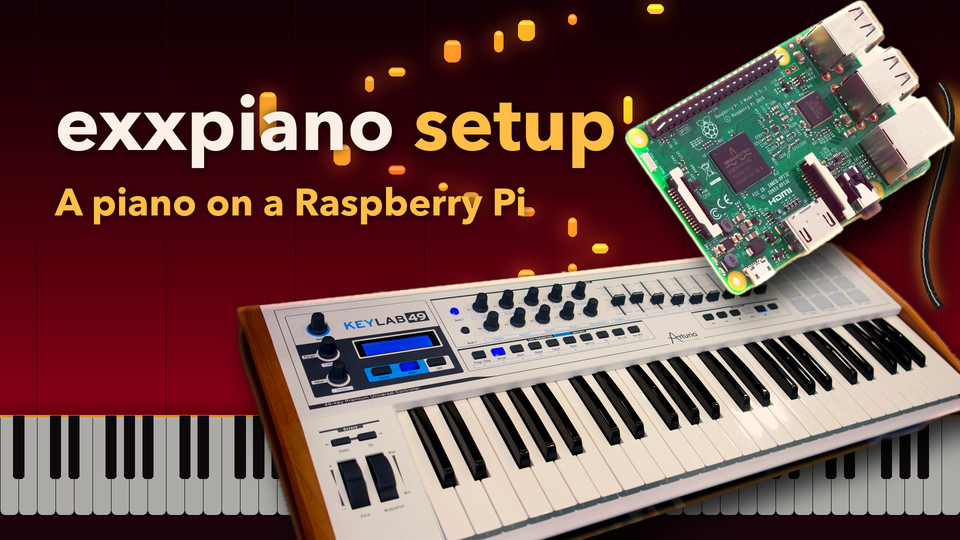
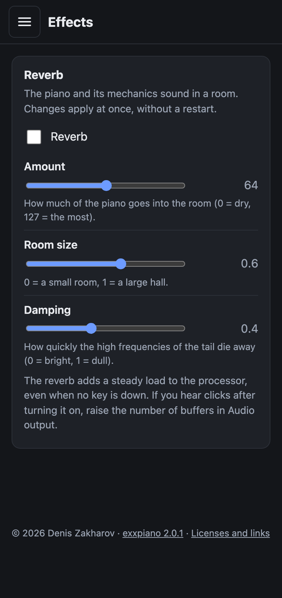
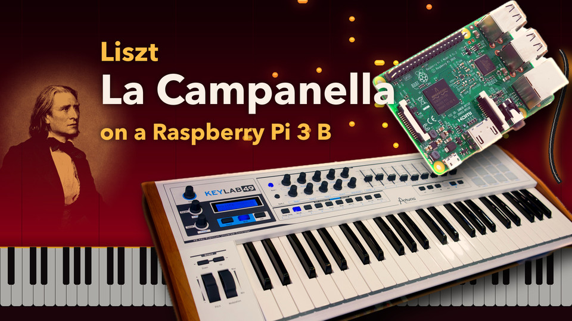

English | [Русский](README.ru.md)


[](https://github.com/exxbrain/exxpiano/actions/workflows/build.yml)
[](https://github.com/exxbrain/exxpiano/actions/workflows/release.yml)
[](https://github.com/exxbrain/exxpiano/releases/latest)

**A piano that sounds.** exxpiano turns a Raspberry Pi (even a used 512 MB Pi 3 A+) into a digital piano for any USB MIDI keyboard: write an image to a card, power the board on, set everything up from a phone. No installation, no screen on the board.

> **Made for boards with 1 GB of memory.** The full grand piano bank (about 700 MB, the one in the videos below) is built to fit a 1 GB board such as the Raspberry Pi 3 Model B, and that is the board it was tuned and tested on. The smaller `lite` bank exists so that a 512 MB board (Pi 3 A+) plays too.
>
> **No computer needed to play.** Once the card is written, the piano is a device on its own: plug in the keyboard and the headphones, power it on and play. The piano starts by itself; the phone is only for changing settings, and the computer only for writing the card.

## Start in 4 steps (nothing to build)

You need a Raspberry Pi 3, 4 or 5 (a Pi 5 also needs a USB sound card), a microSD card, a power supply for your board (**5.1 V / 2.5 A** for a Pi 3, 5.1 V / 3 A for a Pi 4, 5.1 V / 5 A for a Pi 5), a USB MIDI keyboard, and headphones or speakers.

1. **Download** the ZIP for your board from [the latest release](https://github.com/exxbrain/exxpiano/releases/latest): `exxpiano-rpi-…-sd.zip`, the same image for a Pi 3, 4 and 5 (a Pi 5 needs a USB sound card).
2. **Write it to the microSD card** with [Raspberry Pi Imager](https://www.raspberrypi.com/software/): *Choose OS* → *Use custom* → the ZIP as it is (do not unzip it).
3. **Switch it on:** put the card into the Pi, plug in the keyboard and the headphones (3.5 mm jack or a USB sound card) and power it on. The first start is offline. While the full bank loads, a small **preview piano** plays: on a Pi 3 Model B the first note sounds within 15 s of power-on (14.5 s with a stopwatch), and the full bank follows about 32 s after the preview. The piano moves over to the full bank at a moment with no key and no pedal down, without a pause. The preview is plainer: 3 velocity layers, 22 kHz, and notes held longer than 3 s stop with the end of their sample.
4. **Open it from your phone:** join the Wi-Fi network **`exxpiano-Setup-<ID>`** (password **`exxpianosetup`**); the web interface opens by itself or at `http://10.42.0.1:8080/`. In its **Wi-Fi** section connect the Pi to your home network, then open `http://exxpiano-<id>.local:8080/`. The setup network is on for **5 minutes** after the Pi is switched on while it has no saved network (as long as a phone is connected to it, it stays): if you missed it, unplug the power and plug it in again. With an Ethernet cable there is no setup network: open that address directly.

<a href="https://youtu.be/maE7SnMffYA"></a>

[▶ Watch on YouTube](https://youtu.be/maE7SnMffYA)

*The four steps on a real Pi 3 Model B, from the download to the settings on a phone (2:53, the waiting sped up).*

Then play. More about the setup network: [Connecting to a new Wi-Fi](docs/USING.md#connecting-to-a-new-wi-fi); and read "Power supply" below. Building the banks and the image yourself is only for developers: [docs/BUILDING.md](docs/BUILDING.md).

## What it can do

- **Real piano sound:** SoundFont banks through FluidSynth, plus the piano mechanics (hammer and damper noise, string resonance, pedal noise) that the SF2 format cannot express by itself. The ready images carry the Salamander Grand Piano V3 (Yamaha C5); any other `.sf2` / `.sf3` bank can be added from a USB drive and chosen in the web interface, and every bank remembers its own touch and mechanics settings.
- **Made for 1 GB boards:** the `full` bank (about 700 MB) is built for a board with 1 GB; a 512 MB board gets the smaller `lite` bank. The image picks the bank by itself.
- **A ready image:** one ZIP for the Raspberry Pi 3, 4 and 5 (64-bit Alpine Linux); the first start is offline and asks for nothing. The Pi 5 has no 3.5 mm jack and plays through a USB sound card.
- **Automatic choices:** any USB MIDI keyboard is found by itself; the sound goes through a USB sound card (small delay) when there is one, else through the 3.5 mm jack.
- **Setup from a phone:** a web interface for the touch curve, the mechanics, volume, banks, audio output, Wi-Fi (through the device's own setup network and a QR code) and monitoring (processor, temperature, power, memory, errors).
- **From a USB drive:** import sound banks and play MIDI files on the chosen piano, with the mechanics.
- **Open and tested:** open source (scripts MIT, sounds CC-BY, the two demonstration recordings CC BY-NC-SA) with hundreds of automatic tests; what was not tried on a real board is marked as such.

Not yet tried on real hardware: the import from a USB drive (see "Tested on" below).

## What it looks like

      

In order: Home · Piano bank (and the USB import) · Touch and mechanics · Monitor · Wi-Fi · MIDI player · Effects (reverb).

*The pictures are made by `scripts/make-screenshots.py` from the demo `scripts/demo-web.py` (a simulated device: the numbers, the networks and the banks are made up; the pieces are the real recordings of `assets/midi/`), at the width of a phone.*

## What it sounds like

**<i>La Campanella</i> (from 1:48)**

<a href="https://youtu.be/_oCsFN9PC_Q"></a> <a href="https://youtu.be/WpUCxzW6b-o"></a>

▶ Watch on YouTube: [full bank](https://youtu.be/_oCsFN9PC_Q) · [lite bank](https://youtu.be/WpUCxzW6b-o)

**<i>Un Sospiro</i>**

<a href="https://youtu.be/nHJo8DUatrA"></a> <a href="https://youtu.be/ROzxRNCvmKA"></a>

▶ Watch on YouTube: [full bank](https://youtu.be/nHJo8DUatrA) · [lite bank](https://youtu.be/ROzxRNCvmKA)

Left (or top on a phone): the `full` bank; right (or below): the `lite` bank.

*The two pieces that come with the device, played by its MIDI player on a Raspberry Pi 3 Model B running exxpiano 2.0.1 and recorded digitally from the stream the device sends to its sound card: the `full` bank on the left, the `lite` bank on the right, both with the mechanics and 256 voices. Nothing was added to the sound but one gain per recording to bring them all to the same level. The falling notes are drawn from the same MIDI files. The performances are from the MAESTRO dataset and, like these videos, are **CC BY-NC-SA 4.0** (see "Licenses").*

## What you need

| | |
|---|---|
| A Raspberry Pi 3 or 4, or a Raspberry Pi 5 with a USB sound card (one image for all three; the Raspberry Pi 2 is not supported) | an SD card containing the product image |
| **A 5.1 V / 2.5 A power supply (3 A for a Pi 4, 5 A for a Pi 5) and a short cable** | see "Power supply" - this is not a formality |
| A USB MIDI keyboard | class-compliant, no drivers needed |
| Headphones or speakers | the 3.5 mm jack of a Pi 3/4, or a USB sound card (smaller delay; the only choice on a Pi 5) |

## Power supply (read this)

The Pi 3 is very sensitive to its power. Check:

```bash
vcgencmd get_throttled     # must be 0x0
```

Any other value (for example `0x50005`) means the voltage sagged. Effects we saw: clicks in the sound, Wi-Fi dropping
and SSH breaking while copying large files, reboots when a USB device was unplugged. The cure is a **5.1 V / 2.5 A supply
and a short, thick cable** (up to 1 m, 20 AWG wires or thicker, no switch). A long thin cord is the most common cause.
A Pi 4 needs a 5.1 V / 3 A supply and a Pi 5 a 5.1 V / 5 A one (the official USB-C supplies of these boards).

## Tested on

- **Raspberry Pi 3 Model B** (1 GB) with the **Alpine Linux image** (the version after 1.10.22): it boots offline, grows to the card, names itself, every service starts, the full bank loads, a KeyLab Essential 49 mk3 plays, an upgrade through `apk` works; *La Campanella* from the MIDI player recorded at the output had no clipping, gaps or underruns. Not tried yet with this image: the Pi 3 A+, Pi 4 and Pi 5, the setup network, USB sound cards and drives plugged in while it runs.
- **Raspberry Pi 3 Model B** (1 GB) with the full bank on the earlier DietPi image (1.10.22 and older), an Arturia KeyLab Essential 49 mk3 keyboard and the onboard 3.5 mm output. A **Pi 3 A+** (512 MB) plays the smaller `lite` bank (played on a real Pi 3 A+, it works).
- **Raspberry Pi 5** with the **Alpine Linux image** (2.0) and a USB sound card: it boots, the card is chosen by itself, the piano sounds, a card pulled out is shown as gone. Earlier, the Pi 5 (8 GB) with the DietPi `rpi5` image of v1.10.21 and a Zoom U-24 USB interface: the card was chosen by itself, no underruns or errors since the boot, the full bank loaded. Not checked on it yet: re-picking the card when it is plugged in or out, the delay end to end.

Other boards, keyboards and sound cards were not tested. I recommend a USB sound card; its delay was not measured. Which one to get: [docs/USING.md](docs/USING.md#which-usb-card-to-get). The full list with versions and numbers: [docs/ABOUT.md](docs/ABOUT.md#tested-on).

**Start time** (measured on a Pi 3 Model B with the full bank): **the first note within 15 s of power-on** (14.5 s with a stopwatch; a small preview piano plays until the full bank has loaded, about 37 s after the start of the synthesizer). The very first start of a freshly written card also grows the partition to the card and takes longer; it has not been timed with 2.0. Loading the full bank is reading 729 MB from the card at 23 MB/s, the limit of the Pi 3, so a faster card does not help.

**Reverb and the processor** (Pi 3 Model B, Zoom U-24 at 64x2, *La Campanella* from the MIDI player): the reverb roughly doubles the work of the synthesizer. The thread that hands the sound to the card went from 18 % to 33 % of a core, each of the two mixing threads from 12 % to 22 %; the four cores from 16-20 % to 22-30 % on average, the busiest second from 29 % to 58 %. No underruns. The heavier cases with the reverb on, at the same 64x2, also had no underruns: the finale of *La Campanella* peaked at 83 % of a core (31-38 % on average); a synthetic 256 voices at once peaked at 80 % (54-67 % on average); 256 voices with the web page polling often brought 3 of the 4 cores to 100 % at peaks (74-77 % on average, up to 75 °C), which leaves almost no headroom. The reverb is computed all the time it is on, even when no key is down, so it is off by default. Not measured yet: the 3.5 mm jack with the reverb. If the sound clicks with the reverb on, raise the number of buffers in **Audio output** or turn the reverb off.

## Choosing the piano bank

The images carry two banks of the same Salamander piano:

- `full` (about 700 MB): 14 velocity layers, 12 s tails, for a board with 1 GB. **Not for 512 MB.**
- `lite` (237 MB): 6 velocity layers instead of 14, tails of 9 s instead of 12 s, and the softest note is louder (−12 dB instead of −17 dB), so the dynamic range is somewhat smaller. A board with less than 800 MB of memory (a Pi 3 A+) selects it by itself.

They also carry `piano-preview.sf2` (24 MB, 3 layers, stereo at 22 kHz, 3 s tails): it plays only while a bank loads and is not offered as a bank.

Both are in the **Piano bank** section of the web interface. **Use** switches the piano without a restart: the preview plays while the new bank loads (17 s for `lite`, 38 s for `full` on a Pi 3 Model B), so you can keep playing, and if the new bank does not come up, the previous one is put back automatically. **Delete** removes a bank that is not in use, to free space: the current bank, the last good one and the mechanics bank are never deleted, and it cannot be undone. Not tried on a real Raspberry Pi: pressing **Delete** there; the rules are covered by automatic tests. The touch curve, the volume and the mechanics levels are remembered per bank.

Other `.sf2` / `.sf3` banks can be imported from a USB drive (folder `piano-banks/`), and MIDI files to play on the piano the same way (folder `piano-midi/`). The import from a USB drive has not been tried on real hardware yet. Details: [docs/USING.md](docs/USING.md#choosing-the-piano-bank).

## If something does not work

See [docs/TROUBLESHOOTING.md](docs/TROUBLESHOOTING.md). If it does not help, [open an issue](https://github.com/exxbrain/exxpiano/issues/new?template=problem.yml): the form asks for the version, the board, the keyboard and the sound output, which is what it takes to find the cause.

## More

- [Using exxpiano: the details](docs/USING.md): every section of the web interface, the piano banks and the USB drive, MIDI files, Wi-Fi and the setup network, several devices, audio output and latency, the settings file and the mechanics options.
- [How exxpiano works](docs/ABOUT.md): the mechanics, the Salamander limit, the full "Tested on" list, a comparison with alternatives.
- [Building exxpiano yourself](docs/BUILDING.md): the sound banks, upgrading a running Pi, where things live, the web interface without a Raspberry Pi, tests.
- [Building the SD card image](docs/BUILD-IMAGE.md), [Troubleshooting](docs/TROUBLESHOOTING.md), [Changelog](CHANGELOG.md).

## Licenses

The repository's scripts are MIT ([LICENSE](LICENSE)). The [Salamander Grand Piano V3](https://freepats.zenvoid.org/Piano/SalamanderGrandPiano/) sounds are [CC-BY](https://creativecommons.org/licenses/by/3.0/), by Alexander Holm
([NOTICE.md](NOTICE.md)). The `.sf2` files built from them are derivative works, and distributing them requires
attribution.

The two demonstration recordings of real pianists (`assets/midi/`, Liszt's *Un Sospiro* and *La Campanella*) are taken unchanged from the [**MAESTRO dataset v3.0.0**](https://magenta.tensorflow.org/datasets/maestro) (Google LLC) and are licensed [**CC BY-NC-SA 4.0**](https://creativecommons.org/licenses/by-nc-sa/4.0/): non-commercial use only, with attribution, shared under the same license; this covers these files, not the MIT code ([assets/midi/NOTICE.md](assets/midi/NOTICE.md)). The demonstration videos ([YouTube](https://www.youtube.com/channel/UCaqFaRCMmHVezksqe_fxcJg)) are made from these recordings and are under the same license. Delete them if you use exxpiano commercially. Alpine Linux and its packages in the image keep their own licenses.
