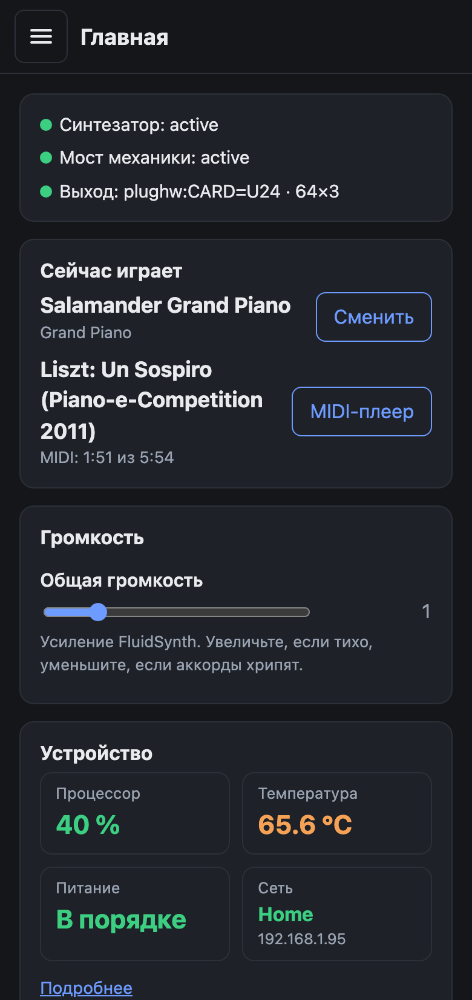
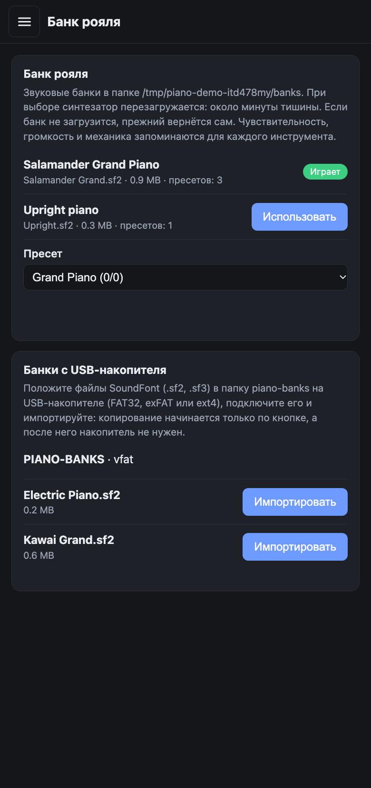
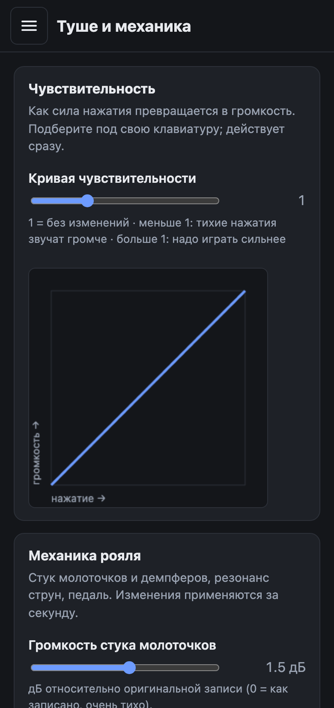
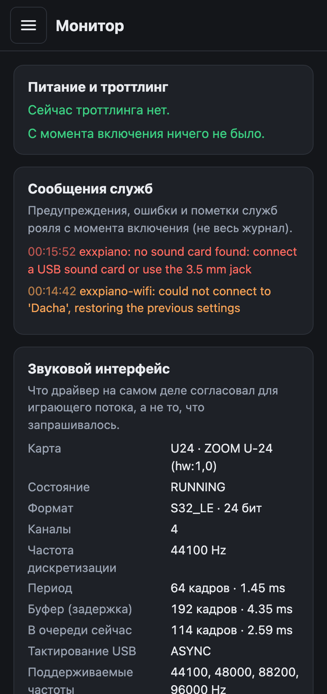
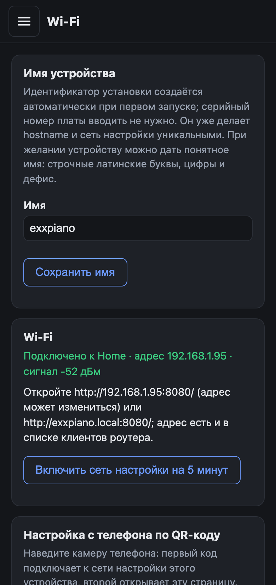
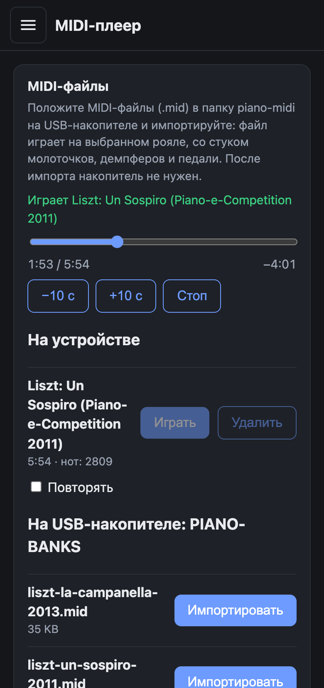

[English](README.md) | Русский


[](https://github.com/exxbrain/exxpiano/actions/workflows/build.yml)
[](https://github.com/exxbrain/exxpiano/actions/workflows/release.yml)
[](https://github.com/exxbrain/exxpiano/releases/latest)

**Хороший звук фортепиано на дешёвой плате при минимуме усилий.** exxpiano превращает Raspberry Pi (даже б/у Pi 3 A+ с 512 МБ) в цифровое пианино для любой USB MIDI-клавиатуры: образ записывается на карту, плата включается, всё настраивается с телефона. Без установки и без экрана на плате. От записи карты до первого звука проходит несколько минут (не хронометрированный замер).

> **Сделано для плат с 1 ГБ памяти.** Полный банк рояля (около 700 МБ, тот, что в видео ниже) рассчитан на плату с 1 ГБ, например Raspberry Pi 3 Model B; на ней он настроен и проверен. Уменьшенный банк `lite` сделан для того, чтобы плата с 512 МБ (Pi 3 A+) тоже играла.
>
> **Чтобы поиграть, компьютер не нужен.** После записи карты пианино работает само по себе: подключите клавиатуру и наушники, включите питание и играйте. Пианино запускается само; телефон нужен только чтобы менять настройки, а компьютер только чтобы записать карту.

## Запуск за 4 шага (ничего собирать не нужно)

Понадобятся Raspberry Pi 2, 3, 4 или 5 (для Pi 5 ещё и USB-звуковая карта), карта microSD, блок питания для своей платы (**5.1 В / 2.5 А** для Pi 2 или 3, 5.1 В / 3 А для Pi 4, 5.1 В / 5 А для Pi 5), USB MIDI-клавиатура и наушники или колонки.

1. **Скачайте** ZIP для своей платы из [последнего релиза](https://github.com/exxbrain/exxpiano/releases/latest): `exxpiano-rpi234-…-sd.zip` для Pi 2/3/4 (`exxpiano-rpi5-…-sd.zip` для Pi 5: ему нужна USB-звуковая карта).
2. **Запишите его на карту microSD** через [Raspberry Pi Imager](https://www.raspberrypi.com/software/): *Choose OS* → *Use custom* → ZIP как есть (распаковывать не нужно).
3. **Включите:** вставьте карту в Pi, подключите клавиатуру и наушники (разъём 3.5 мм или USB-звуковая карта) и подайте питание. Первый запуск идёт без сети и может занять несколько минут.
4. **Откройте с телефона:** подключитесь к Wi-Fi сети **`exxpiano-Setup-<ID>`** (пароль **`exxpianosetup`**); web-интерфейс откроется сам или по адресу `http://10.42.0.1:8080/`. В его разделе **Wi-Fi** подключите Pi к домашней сети, затем откройте `http://exxpiano-<id>.local:8080/`. С кабелем Ethernet сети настройки нет: сразу откройте этот адрес.

Можно играть. Подробности — в разделах «Подключение к новой Wi-Fi», «Питание» и «Звуковой выход и задержка» ниже. «Развёртывание кратко», «Быстрый старт» и «Образ SD-карты» нужны, только если собирать банки и образ самому.

## Возможности

- **Настоящий звук рояля:** банки SoundFont через FluidSynth плюс механика рояля (стук молоточков и демпферов, резонанс струн, стук педали), которую формат SF2 сам выразить не может. В готовых образах лежит Salamander Grand Piano V3 (Yamaha C5); любой другой банк `.sf2` / `.sf3` можно добавить с USB-накопителя и выбрать в web-интерфейсе, а у каждого банка свои запомненные настройки туше и механики.
- **Сделано для плат с 1 ГБ:** банк `full` (около 700 МБ) рассчитан на плату с 1 ГБ; плате с 512 МБ достаётся уменьшенный `lite`. Образ сам выбирает банк.
- **Готовый образ:** один ZIP для Raspberry Pi 2/3/4 и один для Pi 5; первый запуск автономный и ничего не спрашивает. У Pi 5 нет разъёма 3,5 мм, она играет через USB-звуковую карту.
- **Автоматический выбор:** любая USB MIDI-клавиатура находится сама; звук идёт через USB-звуковую карту (малая задержка), если она есть, иначе через разъём 3,5 мм.
- **Настройка с телефона:** web-интерфейс для кривой чувствительности, механики, громкости, банков, звукового выхода, Wi-Fi (через собственную setup-сеть устройства и QR-код) и мониторинга (процессор, температура, питание, память, ошибки).
- **С USB-накопителя:** импорт звуковых банков и воспроизведение MIDI-файлов на выбранном рояле, с механикой.
- **Открытый и проверенный:** открытый код (скрипты MIT, звуки CC-BY, две демонстрационные записи CC BY-NC-SA) и сотни автоматических тестов; что не пробовалось на реальной плате, помечено.

Пока не пробовалось на реальном железе: импорт с USB-накопителя (см. «Проверено на» ниже).

## Как это выглядит

| Главная | Банк рояля (и импорт с USB) | Туше и механика |
|---|---|---|
|  |  |  |

| Монитор | Wi-Fi | MIDI-плеер |
|---|---|---|
|  |  |  |

*Картинки делает `scripts/make-screenshots.py` из демо `scripts/demo-web.py` (имитация устройства: цифры, сети и банки выдуманы; пьесы настоящие, записи из `assets/midi/`), в ширину телефона.*

## Как это звучит

<table>
<tr><th width="50%">Банк full</th><th width="50%">Банк lite</th></tr>
<tr><th colspan="2">«Кампанелла» (с 1:48)</th></tr>
<tr>
<td><video src="https://github.com/user-attachments/assets/5af2d54a-346b-4e7b-b226-b4280eef114d" controls width="100%"></video><br><a href="https://github.com/exxbrain/exxpiano/releases/download/demo-videos/exxpiano-la-campanella-full.mp4">1080p</a></td>
<td><video src="https://github.com/user-attachments/assets/c361e8f3-9bf6-4876-bbb2-815873b3b06a" controls width="100%"></video><br><a href="https://github.com/exxbrain/exxpiano/releases/download/demo-videos/exxpiano-la-campanella-lite.mp4">1080p</a></td>
</tr>
<tr><th colspan="2">«Вздох»</th></tr>
<tr>
<td><video src="https://github.com/user-attachments/assets/c7ed836e-0145-4758-84f3-e3ed269441a2" controls width="100%"></video><br><a href="https://github.com/exxbrain/exxpiano/releases/download/demo-videos/exxpiano-un-sospiro-full.mp4">1080p</a></td>
<td><video src="https://github.com/user-attachments/assets/7e61fa66-f521-474f-8c34-18ba92c9312f" controls width="100%"></video><br><a href="https://github.com/exxbrain/exxpiano/releases/download/demo-videos/exxpiano-un-sospiro-lite.mp4">1080p</a></td>
</tr>
</table>

*Две пьесы, которые идут с устройством: их сыграл MIDI-плеер на Raspberry Pi 3 Model B с exxpiano 1.10.21, звук записан с устройства: слева банк `full`, справа `lite`, оба с механикой и 256 голосами. К звуку ничего не добавлено, кроме одного усиления на запись, чтобы все записи были одной громкости. Падающие ноты нарисованы по тем же MIDI-файлам. Исполнения взяты из набора MAESTRO и, как и эти видео, распространяются по **CC BY-NC-SA 4.0** (см. «Лицензии»).*

## Как это устроено

Готовое цифровое пианино для Raspberry Pi 2/3/4/5 (ARMv8): банки SoundFont через FluidSynth (в готовых образах лежит **Salamander Grand Piano V3**, Yamaha C5; механика настроена на него, поэтому с другим банком уровни, возможно, придётся подстроить в web-интерфейсе) плюс
**механика рояля** — стук молоточков и демпферов, резонанс струн, стук педали, — которой в формате SF2
нет, поэтому её добавляет небольшая программа-мост.

```
USB MIDI-клавиатура ─► exxpiano-fx.py ─► FluidSynth ─► звуковой выход
                          │             ├─ piano.sf2  (рояль, канал 0)
                          └─ механика ─►└─ mech.sf2   (каналы 1–6)
```

Всё запускается само при включении Pi, клавиатуры подключаются автоматически: мост опрашивает MIDI-порты каждые 2 секунды.
Подключение «на горячую» так предусмотрено, но на Pi проверялось только подключение при старте.

**Клавиатура выбирается автоматически, без привязки и настройки.** Мост каждые 2 секунды смотрит на MIDI-порты и берёт все аппаратные MIDI-входы, кроме служебных (Through, Timer, Announce, FLUID и подобных), поэтому любая USB-клавиатура класса class compliant работает, как только подключена, несколько клавиатур могут играть одновременно, а мост сам переподключается к синтезатору, когда тот перезапускается. Подключение при загрузке проверено на Pi с Arturia KeyLab Essential 49 mk3; подключение во время работы предусмотрено, но не проверено.

**Звуковой выход выбирается автоматически, чтобы задержка была меньше.** Если подключена внешняя USB-звуковая карта или аудиоинтерфейс, exxpiano играет через неё с очень маленьким буфером (64 кадра × 3, около 4,4 мс буфера плюс собственная задержка интерфейса); без неё звук идёт на разъём 3,5 мм платы, где драйвер увеличивает буфер до 444 кадров (по расчёту около 30 мс). Выбор делается при запуске службы, буферы запоминаются для каждого интерфейса. Задержка целиком не измерялась; Zoom U-24 на Pi 3 играл без щелчков, а на Pi 5 выбрался сам и работал без провалов звука.

## Проверено на

- Raspberry Pi 3 Model B (1 ГБ; для Pi 3 A+ с 512 МБ нужен уменьшенный банк `lite`, см. ниже), DietPi (Debian, FluidSynth 2.4.4), клавиатура Arturia KeyLab Essential 49 mk3,
  штатный выход 3.5 мм;
- Raspberry Pi 5 (8 ГБ) с образом `exxpiano-rpi5-…` версии 1.10.21 (DietPi 10.7.2) и USB-интерфейсом Zoom U-24: карта выбрана сама (`plughw:CARD=U24`, 64 × 3, около 4,4 мс буфера, 44,1 кГц, `S32_LE`, 4 канала), индикатор уровня на ней работает, с момента загрузки ни провалов звука, ни ошибок, ни недонапряжения, ни троттлинга, полный банк загрузился, занято 953 из 8046 МБ. На ней пока не проверены: перевыбор карты при подключении и отключении, задержка целиком;
- сборка банков — на macOS (Apple Silicon), FluidSynth 2.6.1, ffmpeg.

На других платах, клавиатурах и звуковых картах не проверялось. USB-звуковую карту я рекомендую (см. «Задержка»);
её задержка не измерялась.

## Что понадобится

| | |
|---|---|
| Raspberry Pi 2, 3 или 4 (образ `rpi234`) или Raspberry Pi 5 с USB-звуковой картой (образ `rpi5`) | SD-карта с образом продукта |
| **Блок питания 5.1 В / 2.5 А (3 А для Pi 4, 5 А для Pi 5) и короткий кабель** | см. «Питание» — это не формальность |
| USB MIDI-клавиатура | «class compliant», драйверы не нужны |
| Только для сборки самому: Mac или Linux для банков | `python3`, `ffmpeg` (вместе с `ffprobe`), `curl`, `tar` с xz; ~2 ГБ места |

## Развёртывание кратко

Поставляемый продукт — готовое устройство с уже установленным exxpiano. Один полный образ DietPi используется для всех совместимых Raspberry Pi 2/3/4 (у Pi 5 свой образ, он собирается с `--target rpi5`); отдельный пакет или архив-установщик не является форматом поставки.

1. Один раз соберите банки: `scripts/make-soundfonts.sh -p full` и `-p lite` (второй берёт уже скачанные сэмплы). Получатся обязательные `build/piano-full.sf2` и `build/mech.sf2` и уменьшенный `build/piano-lite.sf2` для плат с 512 МБ.
2. Соберите универсальный образ: `scripts/build-sd-image.py --dietpi <DietPi_RPi234-ARMv8...img.xz>`. 
3. Запишите `exxpiano-rpi234-v<VERSION>-dietpi-<DIETPI_VERSION>-sd.zip` прямо на чистую SD-карту через Raspberry Pi Imager или balenaEtcher.
4. Вставьте карту в совместимую Raspberry Pi 2, 3 или 4 и включите питание.

Полная процедура и текущий статус проверок описаны в [руководстве по сборке образа](docs/BUILD-IMAGE.ru.md).
Теги версий с именем `v<VERSION>` собирают этот образ и публикуют его вместе с манифестом, README и контрольными суммами как assets GitHub Release.

## Быстрый старт (сборка самому)

### 1. Собрать звуковые банки (на Mac/Linux)

Сами банки в репозитории не хранятся (сотни мегабайт, лицензия Salamander — CC-BY, см. [NOTICE.md](NOTICE.md)).
Их делает скрипт из оригинального архива:

```bash
scripts/make-soundfonts.sh -p full -o build          # скачает ~412 МБ и соберёт
```

Если Salamander у вас уже распакован (папка с `SalamanderGrandPianoV3Retuned.sfz`), укажите её: `-s /путь/к/папке`.

Результат: `build/mech.sf2` (36 МБ) и `build/piano-<пресет>.sf2`.

#### Выбор пакета сэмплов (`-v`)

Salamander опубликован на [FreePats](https://freepats.zenvoid.org/Piano/acoustic-grand-piano.html) в нескольких пакетах. Сборщики
находят файлы сэмплов по путям из SFZ и приводят всё к 44.1 кГц / 16 бит, поэтому готовые банки получаются одного размера
независимо от пакета; источник влияет только на точность преобразования и на объём загрузки.

```bash
scripts/make-soundfonts.sh -p full -v 48k24 -o build     # взять пакет WAV 48 кГц / 24 бит
```

| `-v` | Пакет | Загрузка | Статус |
|---|---|---|---|
| `44k16` (по умолчанию) | SFZ WAV, 44.1 кГц 16 бит | 412 МБ | собирался и работает на настоящей Pi |
| `48k24` | SFZ WAV, 48 кГц 24 бита | 1.26 ГБ | проверен на копии набора `44k16`, преобразованной в этот формат (звук совпадает с `44k16`, разница на 67 дБ ниже сигнала); реальная загрузка 1.26 ГБ **не** пробовалась |
| `48k24-flac` | SFZ FLAC, 48 кГц 24 бита (пакет от 2020-06-02) | 742 МБ | **экспериментальный**: механизм (FLAC, другие папки) проверен на синтетическом наборе, но структура реального архива и имя SFZ не изучались; если SFZ не найден, укажите `-n ИМЯ` |

Для любого другого SFZ-пакета Salamander есть `-u URL` (и `-n ИМЯ`, если SFZ-файл называется иначе). Таблица слоёв в сборщике
рассчитана на 16 слоёв громкости набора V3. На FreePats есть и готовый SF2 Salamander; здесь он не используется, потому что в нём нет
пресетов механики и уменьшения слоёв.

| Пресет | Размер в RAM Pi | Что это | `GAIN` | Проверено на Pi 3 |
|---|---|---|---|---|
| `lite` | ~250 МБ | 6 слоёв, стерео, хвосты 9 с | 0.6 | близкий вариант (нагрузка CPU ~30%) |
| `full` | ~700 МБ | 14 слоёв, стерео, хвосты 12 с; для платы с 1 ГБ (резерв памяти для таких плат 200 МБ). **Не для 512 МБ** | 0.6 | запускается и играет на плате с 1 ГБ; на слух звучит лучше прежнего банка на 390 МБ и значительно лучше готовой облегчённой версии Salamander из официальной библиотеки (один слушатель, не слепой тест); свободная память после загрузки не записана, смотрите `free -m` |

Файл целиком читается в оперативную память. У Pi 3 Model B/B+ её 1 ГБ, а у **Pi 3 Model A+ всего 512 МБ (около 414 МБ доступно)**, и `full` там не помещается:
на реальной Pi 3 A+ ядро убивало FluidSynth с банком 390 МБ на 370 МБ (`Out of memory: Killed process (fluidsynth)`), и служба перезапускалась снова и снова. Берите `lite`
(237 МБ; **проверен на реальной Pi 3 A+, работает**, в том числе автоматический выбор при первом запуске). `lite` против `full`: 6 слоёв громкости
вместо 14, хвосты 9 с вместо 12 с, самая тихая нота громче (−12 дБ вместо −17 дБ), поэтому динамический диапазон немного меньше. Свободную память проверьте сами (`free -m`, столбец `available`).

### Ограничение Salamander и как его обходит exxpiano

Salamander Grand Piano V3 записан для компьютера: 16 слоёв громкости на каждую ноту, длинные хвосты, отдельные записи механики. В сжатом виде он скачивается 412 МБ, а распакованные записи занимают заметно больше, при этом FluidSynth читает банк целиком в оперативную память. Для дешёвой платы с 512 МБ или 1 ГБ набор целиком не подходит.

Поэтому exxpiano не пытается загрузить оригинал, а собирает из него **сокращённые SF2-банки**: оставляет часть слоёв (14 из 16 в `full`, 6 в `lite`), обрезает хвосты с плавным затуханием, выравнивает уровни слоёв и добавляет мягкую зависимость громкости от силы нажатия. Механика (молоточки, демпферы, резонанс, педаль) вынесена в отдельный небольшой банк, потому что SF2 не умеет правил SFZ. В итоге:

- на плате с **1 ГБ** играет `full` (около 700 МБ); на слух он звучит лучше прежнего банка на 390 МБ и значительно лучше готовой облегчённой версии Salamander из официальной библиотеки;
- на **самой дешёвой Pi 3 A+ с 512 МБ** играет `lite` (около 237 МБ), проверено на реальной плате.

Что за это платим: меньше слоёв громкости и более короткие хвосты, чем в оригинале; у `lite` тихие ноты немного громче и динамический диапазон чуть уже. Насколько это слышно, оценивалось на слух, не измерялось. `full` сравнивали на слух с готовой облегчённой версией Salamander из официальной библиотеки, и он звучит значительно лучше; `full` с оригиналом не сравнивался, а наш `lite` не сравнивался ни с `full`, ни с этой версией. Сравнения оригинала с банками exxpiano по звуку у нас нет.

## Сравнение с альтернативами

Сравнение составлено по описаниям проектов и обзорам, а не по собственным замерам: звук, задержка и потребление ресурсов у конкурентов мной не измерялись. Цены меняются, проверяйте актуальные на сайтах производителей.

| | exxpiano | Pianoteq на Raspberry Pi | Zynthian | Самодельный FluidSynth на Pi (FluidPi, PiPiano и подобные) |
|---|---|---|---|---|
| Звук | сэмплы Salamander Grand Piano V3 (CC-BY) через FluidSynth плюс отдельная механика (молоточки, демпферы, резонанс, педаль) | физическое моделирование (Modartt); мало памяти, звук считается на лету | много движков (рояль, электропиано, синтезаторы, SoundFont и др.) | любой SoundFont; механики рояля нет |
| Цена ПО | бесплатно, открытый код (скрипты MIT, звуки CC-BY) | платная лицензия | ПО открытое; готовый комплект Zynthian 5 с экраном и ручками — около 490 € без VAT без Raspberry Pi и около 570 € с ней (по обзору) | бесплатно |
| Оборудование | Raspberry Pi 2/3/4/5 (Pi 5 через USB-звуковую карту), достаточно платы с 512 МБ (Pi 3 A+), ни экрана, ни кнопок | чаще сообщают о Pi 4/5 с 64-битной системой; на Pi 3 есть сообщения об успешной работе в домашних условиях | официальный комплект v5.1 на Raspberry Pi 5 с экраном и платой управления; поддерживаются также Pi 4, 3 и 3B+, рекомендуют Pi 4 и выше (Pi 3 хуже тянет несколько движков сразу); Pi 3 A+ и минимальный объём памяти в документации не упомянуты, по сообщению на форуме ZynthianOS занимает почти 1 ГБ памяти; Pi 2 образом не поддерживается | любая плата, на которой работает FluidSynth (Pi Zero и выше) |
| Готовый образ | да, один ZIP, работает с первого включения без монитора | нет, ставится вручную | да, образ ZynthianOS: около 7 ГБ в сжатом виде и около 16 ГБ распакованный, карта не меньше 32 ГБ; есть облегчённый вариант с уменьшенной библиотекой SoundFont | нет, обычно инструкция и скрипты |
| Настройка с телефона | да: кривая чувствительности, механика, банки, звуковой выход, Wi-Fi, монитор | нет единого web-интерфейса; настройка в самой программе | экран и ручки на устройстве, веб-интерфейс есть | в лучшем случае простой интерфейс выбора банка |
| Механика рояля | да, отдельный банк и мост | встроена в физическую модель | зависит от выбранного движка | нет |
| Изменение звука | банки меняются (любые `.sf2`), параметры механики и чувствительности настраиваются | множество параметров модели | зависит от движка | только смена SoundFont |

Где exxpiano слабее: нет физического моделирования (звук ограничен записанными слоями и памятью платы, на дешёвой плате с 512 МБ банк `lite` проще основного), нет экрана и ручек на корпусе (всё с телефона), нет встроенных синтезаторов, кроме рояля, а задержка пока не измерена. Где сильнее: бесплатный открытый код, готовый образ, работа на самой дешёвой плате без монитора, понятный web-интерфейс настроек и отдельная механика рояля.

Источники: [форум Modartt о Pianoteq на ARM](https://forum.modartt.com/viewtopic.php?id=7220), [документация Zynthian Software](https://wiki.zynthian.org/index.php/Zynthian_Software), [документация Zynthian Hardware](https://wiki.zynthian.org/index.php/Zynthian_Hardware), [форум о памяти](https://discourse.zynthian.org/t/how-much-ram-4-vs-8-gb/6109), [Zynthian 5 (обзор)](https://www.yahoo.com/entertainment/zynthian-5-standalone-open-source-110034729.html), [FluidPi](https://github.com/schollz/FluidPi), [PiPiano](https://jpralves.net/post/2020/03/05/pipiano.html).

## Образ SD-карты для новых устройств

Это один универсальный ZIP, записываемый на любое число чистых карт. Внутри DietPi, приложение и банки: рояль (`full`, около 700 МБ, ставится как `piano.sf2`) и механика обязательны, уменьшенный `piano-lite.sf2` добавляется, если есть `build/piano-lite.sf2` (в релизе он всегда есть). На плате с памятью меньше 800 МБ (Pi 3 A+) первый запуск сам выбирает `piano-lite.sf2`, а при каждом запуске `exxpiano-run` заменяет настроенный банк, не помещающийся в память, самым большим из меньших банков библиотеки и записывает выбор в `/etc/exxpiano.conf` (в журнале «does not fit into the memory»); на больших платах остаётся рояль образа, а `lite` можно выбрать в разделе «Банк рояля» web-интерфейса. При первом старте каждая установка сама создаёт
случайный постоянный 16-значный hex-ID. Из ID получаются уникальные hostname
`exxpiano-<id>` и сеть настройки `exxpiano-Setup-<ID>`.

```bash
# один раз: скачайте DietPi_RPi234-ARMv8-Trixie.img.xz с dietpi.com (или добавьте --download, и скрипт скачает сам)
printf 'Пароль DietPi: '; read -r -s SD_PASSWORD; printf '\n'
printf 'Пароль сети настройки: '; read -r -s SD_AP_PASSWORD; printf '\n'
export SD_PASSWORD SD_AP_PASSWORD
python3 scripts/build-sd-image.py --dietpi ~/Downloads/DietPi_RPi234-ARMv8-Trixie.img.xz \
    --country RU --timezone Europe/Moscow
unset SD_PASSWORD SD_AP_PASSWORD
```

Получится `dist/sd/`: версионированный образ карты `exxpiano-rpi234-v<VERSION>-dietpi-<DIETPI_VERSION>-sd.zip`, `manifest-rpi234.json` и `README-rpi234.txt`. Для **Raspberry Pi 5** добавьте `--target rpi5` и передайте образ DietPi для Pi 5 (`DietPi_RPi5-ARMv8-Trixie.img.xz`): в релизе есть отдельный ZIP `exxpiano-rpi5-…`. У Pi 5 нет разъёма 3,5 мм, поэтому она играет только через USB-звуковую карту или аудиоинтерфейс, а её образ несёт банк `full` и, как ещё один вариант, `lite`. Образ для Pi 5 запущен на Raspberry Pi 5 (8 ГБ) и играл через USB-звуковую карту (см. «Проверено на»). Запишите ZIP через **Raspberry Pi Imager**
(«Choose OS» -> «Use custom») или **balenaEtcher** (оба берут zip как есть); вручную «раззиповать» на карту нечего, потому что карте Raspberry Pi нужны разделы, а их несёт только образ.
Включайте Pi без предварительной настройки сети: продуктовый образ пропускает сетевое обновление DietPi при первом запуске. Устройство открывается по
`http://exxpiano-<id>.local:8080/`, а без Ethernet и сохранённой Wi-Fi включает свою уникальную сеть настройки (см. «Подключение к новой Wi-Fi»).

- **Идентичность установки.** ID создаётся из криптографически случайных 24 бит (6 шестнадцатеричных символов) один раз и хранится в `/var/lib/exxpiano/installation-id`. Полный ID входит в setup SSID и QR-коды; две установки в одной комнате почти никогда не получают одно имя (копия, созданная прежней версией, сохраняет длинный ID). Пошагово: **[docs/BUILD-IMAGE.ru.md](docs/BUILD-IMAGE.ru.md)**.
- **Как собирается.** В Linux-контейнере (Docker Desktop должен быть запущен; на Linux с root есть `--no-docker`): образ открывается, в него ставятся пакет и его зависимости
  (`apt`, без рекомендуемых пакетов), копируются банки, а DietPi переводится в режим предустановленной автономной системы. При первом запуске DietPi не управляет `wlan0`,
  не ждёт сеть и не проверяет обновления; радио и сеть настройки запускает `exxpiano-wifi`. Готовый образ перечитывается, а его веб-служба запускается в контейнере как
  проверка. Пароли передаются через окружение, не через аргументы.
- **Честный статус.** Вся сборка проверена на образе-заменителе с раскладкой DietPi, и программы внутри готового образа запускаются; образ для Pi 5 версии 1.10.21 запущен на Raspberry Pi 5.
  После изменений в сборщике запишите первую карту, понаблюдайте за запуском и прочитайте `/var/log/exxpiano-firstboot.log`. `--download` с dietpi.com тоже не пробовалось: если адрес изменился, скачайте
  образ сами и укажите `--dietpi`. Образ-заменитель (`scripts/sd-fake-dietpi.sh`) и `scripts/sd-smoke-test.sh` нужны, чтобы проверять изменения сборщика без Pi.

**Экран устройства ничего не спрашивает.** С монитором на HDMI консоль показывает экран состояния (ID установки, имя, адреса web-интерфейса, setup-сеть при отсутствии сети) вместо приглашения `login:`, так что на устройстве, которым пользуются без монитора, ничего вводить не нужно. Локального входа и автовхода root нет; администрируйте устройство по SSH (пользователь `root`, пароль DietPi).

## Обновление работающей Pi

```bash
scripts/deploy-to-pi.sh 192.168.1.95        # или user@host; вход по SSH-ключу
```

Скрипт собирает пакет, отправляет его на Pi и обновляет там: сохраняет `/etc/exxpiano.conf`, сначала делает резервную копию старой версии,
проверяет, что синтезатор и мост поднялись, и сам откатывается, если нет (`deploy/upgrade-on-pi.sh`, вручную: `deploy/rollback-on-pi.sh`).
Звуковые банки не затрагиваются.

**Пароли при обновлении.** Скрипт входит по вашему SSH-ключу и не спрашивает ни пароль, ни подтверждение ключа хоста. На устройстве, где вашего ключа ещё нет (новая карта, переустановленный образ), он ставит ключ через `ssh-copy-id`: пароль SSH спрашивается **один этот раз**. Ключ на вашем компьютере нужен (`ls ~/.ssh/*.pub`; если нет: `ssh-keygen -t ed25519`). Если ключ поставить не удалось, скрипт переходит на обычный вход по паролю (спросит один раз), а не останавливается: на самом устройстве, у которого нет монитора, никогда ничего не спрашивается. Пароль DietPi `dietpi`, если при сборке образа не задан `SD_PASSWORD` (`--password`). Изменившийся ключ хоста по-прежнему останавливает скрипт: это повод проверить, а не обойти.

## Где что лежит

Всё в этой одной папке. Git игнорирует большие генерируемые части, поэтому их нельзя закоммитить (хук коммита дополнительно отклоняет любой файл больше 5 МБ):

| Папка | Что | В git |
|---|---|---|
| `pi/`, `tools/`, `scripts/`, `deploy/`, `dietpi/`, `packaging/`, `tests/`, `docs/` | программа, сборщик образа, внутренняя упаковка, тесты | да |
| `build/` | собранные банки (`mech.sf2`, `piano-<пресет>.sf2`), скачанный Salamander в `build/salamander-44k16/`, старые банки в `build/archive/` | нет |
| `dist/sd/` | универсальный полный SD-образ и его метаданные | нет |

## Питание (читать обязательно)

Pi 3 очень чувствительна к питанию. Проверка:

```bash
vcgencmd get_throttled     # должно быть 0x0
```

Любое другое значение (например `0x50005`) означает, что напряжение просело. Последствия, которые мы наблюдали:
щелчки в звуке, пропадающий Wi-Fi и обрыв SSH при копировании больших файлов, перезагрузки при отключении USB-устройств.
Лечится **блоком 5.1 В / 2.5 А и коротким толстым кабелем** (до 1 м, сечение жил 20 AWG и толще, без выключателя).
Длинный тонкий шнур — самая частая причина.
Pi 4 нужен блок 5.1 В / 3 А, а Pi 5 — 5.1 В / 5 А (официальные блоки USB-C для этих плат).

## Звуковой выход и задержка

- **Штатный 3.5 мм:** образ его включает (`dtparam=audio=on` в `/boot/firmware/config.txt`; в системе, настроенной вручную: `dietpi-config` → Audio Options),
  устройство `plughw:Headphones`. Драйвер bcm2835 сам увеличивает период буфера до 444 сэмплов, поэтому задержка
  около 30 мс (при `PERIODS=3`); `PERIODS=2` даёт ~20 мс, но возможны щелчки. Значение по умолчанию `PERIOD_SIZE=64` x `PERIODS=3` (минимум, который принимает FluidSynth; драйвер округляет его вверх) на Pi 3 играло без щелчков; если они появятся, увеличьте `PERIOD_SIZE` в web-интерфейсе. Выход шумноват.
- **USB-звуковая карта / аудиоинтерфейс:** лучшее решение. Просто подключите: `ALSA_DEVICE=auto` (по умолчанию) предпочитает USB-карту и
  использует меньший буфер `USB_PERIOD_SIZE=64` x `USB_PERIODS=3` (64 кадра = 1.45 мс на период, около 4.4 мс буфера; сверх этого добавляется собственная задержка USB и преобразователей интерфейса). Устройство открывается через слой ALSA `plughw`, и это
  важно: многие интерфейсы принимают только 24/32 бита или 4 канала, и прямое открытие (`hw:`) падает с ошибкой
  `Failed to find an audio format supported by alsa`.
  Проверено: Zoom U-24 (показывает `S32_LE`, 4 канала, 44.1-96 кГц) на Pi 3 с `64 x 3`: на слух без щелчков, задержка не измерялась; на Pi 5 этот же интерфейс выбрался сам и работал с `64 x 3` без провалов звука.
  Карта выбирается при запуске службы (на загрузке служба ждёт USB-карту `USB_WAIT` секунд). Повторный выбор при подключении и
  отключении карты делает правило udev, написанное по документации и **не проверенное на железе**; если не сработает, выполните
  `sudo systemctl restart exxpiano` после смены интерфейса.

## Настройка

Всё в `/etc/exxpiano.conf`. После правки: `sudo systemctl restart exxpiano exxpiano-fx`.

| Параметр | Что делает |
|---|---|
| `GAIN` | общая громкость синтезатора (0.2 — значение FluidSynth по умолчанию; **0.6** — самая громкая настройка, при которой самая плотная из проверенных пьес не срезается; ползунок в web-интерфейсе — шкала в дБ вокруг этого значения, искажаться может только его конец) |
| `POLYPHONY` | число голосов (по умолчанию 256, это максимум); стерео — по два голоса на ноту, механика добавляет ещё |
| `METER` | 1 = выход идёт через измеритель уровня: раздел **«Главная»** показывает пик левого и правого каналов и считает отсчёты на полной шкале (срез). Стоит около 3% одного ядра; 0 — играть на карту напрямую |
| `CPU_CORES` | потоки синтеза FluidSynth (1–4, по умолчанию 3; одно ядро всегда свободно): голоса плотной пьесы делятся между ядрами платы, поэтому можно поднять `POLYPHONY` (192 или 256) (есть и в разделе **«Звуковой выход»**) |
| `ALSA_DEVICE` | `auto` (USB-карта, если есть, иначе штатный выход) или явное устройство, например `plughw:U24` |
| `PERIOD_SIZE`, `PERIODS` / `USB_PERIOD_SIZE`, `USB_PERIODS`, `USB_WAIT` | буфер для штатного выхода / для USB-карты и сколько ждать её при загрузке |
| `REVERB` | 1 — включить реверберацию FluidSynth (нагрузка на CPU выше) |
| `FX_ARGS` | параметры механики, см. ниже |

### Настройка механики (`FX_ARGS`)

| Параметр | По умолчанию | Смысл |
|---|---|---|
| `--hammer-boost ДБ` | 1.5 | громкость стука молоточков; 0 — как в SFZ (очень тихо), +6 заметно громче |
| `--hammer-exp N` | 0.8 | зависимость стука от силы нажатия: амплитуда ~ (velocity/127)^N. Больше — тихая игра беззвучнее. 0.6–1.0 — мягко, 2.0 — резко |
| `--random R` | 1.6 | случайность стука и педали: 0 — выключена, 1 — норма, 2 — сильная. Меняются громкость и (у молоточка) выбор сэмпла соседней клавиши |
| `--res-boost ДБ` | 0 | громкость резонанса струн |
| `--pedal-boost ДБ` | 4.5 | громкость стука педали |
| `--velocity-curve G` | 1.0 | кривая чувствительности всего рояля: выход = 127 * (вход/127)^G. 1 = без изменений, меньше 1 тихие нажатия звучат громче, больше 1 надо играть сильнее |
| `--res-floor ДБFS` | -64 | голоса резонанса струн тише этого порога не запускаются: они на 35–70 дБ тише рояля и лишь занимают голоса синтезатора (плотной пьесе с педалью их нужны сотни). -200 = запускать все |
| `--res-burst N` | 0 | когда педаль отпускается, запускается не больше N самых громких голосов резонанса, остальные отдают свою мощность уровнем; 0 = без ограничения, 10 — сильное ограничение |
| `--res-makeup ДБ` | 6 | сколько дБ максимум возвращает ограниченная пачка голосов уровнем |

## Выбор банка рояля

В web-интерфейсе есть карточка **«Банк рояля»**: она показывает звуковые банки (`*.sf2`, `*.sf3`) из папки `BANK_DIR` (по умолчанию
`/opt/exxpiano/soundfonts`; банк механики не предлагается). **«Использовать»** переключает рояль: синтезатор перезагружается (около минуты
тишины). Если новый банк не загрузится, прежний возвращается сам, и web-интерфейс об этом скажет. Банк отклоняется с показом причины, если он повреждён
или слишком велик для памяти устройства (на Pi 3 около 500 МБ). Если в банке несколько пресетов, карточка предложит ещё и список **«Пресет»**
(применяется сразу); программы 1-6 банка 0 не предлагаются, потому что там отвечает банк механики.

Карточка показывает и память: сколько её на устройстве, какой банк ещё помещается (системе остаётся резерв, банк механики занимает свою долю), свободное место на карте, полосу с текущим банком и для каждого банка его долю от этого предела. **«Удалить»** убирает неиспользуемый банк, установленный или импортированный, чтобы освободить место: текущий банк, последний рабочий и банк механики не удаляются никогда, пока идёт переключение банка, удалять нельзя, а вопрос предупреждает, что отменить нельзя (установленный банк возвращается только установкой заново или новой картой). Не проверено на реальной Raspberry Pi: нажатие **«Удалить»** там; правила покрыты автотестами.

Если выбранный банк потом пропадёт или повредится (удалённый файл), модуль запустится с `PIANO_SF2_LAST_GOOD`, то есть с последним рабочим банком,
а не останется без звука. Выбрать можно только имена файлов, которые видит папка библиотеки: web-интерфейс никогда не присылает путь.

**Настройки идут за инструментом.** Кривая чувствительности, общая громкость, уровни механики, случайность и пресет запоминаются **для каждого банка**
(в `/var/lib/exxpiano/profiles.json`, ключ — имя файла банка, поэтому переименованный файл начинает с нуля). Подвинули ползунок: значение сохранено
для играющего банка; выбрали другой банк: вернулись его собственные настройки, а при возврате снова прежние. Банк, на котором ещё не играли, стартует с настроек,
действовавших в тот момент. Звуковой выход, буферы, полифония и переключатель реверберации принадлежат устройству и одинаковы для всех банков.
Если переключение не удалось, возвращаются прежний банк и его настройки.

Чтобы добавить банк, скопируйте `.sf2` в `BANK_DIR` (например `scp -O my.sf2 root@<Pi>:/opt/exxpiano/soundfonts/`).

### Импорт банков с USB-накопителя

Чтобы добавить банк, SSH не нужен. Положите файлы SoundFont (`.sf2`, `.sf3`) в папку `piano-banks/` в корне USB-накопителя (FAT32, exFAT или ext4), подключите накопитель к Pi и откройте раздел **«Банк рояля»** в web-интерфейсе: карточка **«Банки с USB-накопителя»** покажет файлы. Кнопка **«Импортировать»** копирует выбранный файл в собственную библиотеку устройства (`/var/lib/exxpiano/banks/`); копирование начинается только по кнопке, никогда само. После этого накопитель не нужен: импортированный банк остаётся после извлечения и перезагрузки, виден в списке с пометкой «импортирован» и удаляется кнопкой **«Удалить»** (банк, который играет, и последний рабочий банк удалить нельзя).

Как это защищено: накопитель монтируется только для чтения (`ro,nosuid,nodev,noexec`), его файлы никогда не исполняются; предлагаются только обычные файлы из `piano-banks/` (без ссылок, вложенных папок, скрытых файлов и без `mech.sf2`); браузер никогда не присылает путь, только имя файла, который накопитель только что показал; копирование идёт во временную папку, результат проверяется (SoundFont, размер против памяти платы, свободное место) и публикуется одним шагом, поэтому вынутый накопитель посередине или полная карта не оставляют недокопированного банка. Одновременно идёт один импорт.

**Что проверено, а что нет.** Логика (список, безопасность имён, транзакция, ошибки, API, интерфейс в демо `scripts/demo-web.py`) покрыта автоматическими тестами. **На реальной Raspberry Pi не пробовалось:** монтирование накопителей FAT32, exFAT и ext4, правило udev (`90-exxpiano.rules`) и юнит `exxpiano-usb@.service`, извлечение накопителя во время копирования и то, что делает копирование 400 МБ с воспроизведением и питанием (смотрите раздел «Монитор»; при недостаточном напряжении нужен хаб с питанием). Не играйте, пока копируется большой банк. Если накопитель не предлагается, посмотрите `journalctl -u 'exxpiano-usb@*'` и проверьте, что файловая система одна из трёх. NTFS не поддерживается. `bank.json` (автор и лицензия банка) пока не читается.

### Воспроизведение MIDI-файлов с USB-накопителя

Положите MIDI-файлы (`.mid`, `.midi`) в папку `piano-midi/` в корне USB-накопителя (того же, что и для банков, FAT32, exFAT или ext4) и откройте раздел **«MIDI-плеер»** web-интерфейса (отдельный пункт меню): он покажет их. **«Импортировать»** копирует выбранный файл в собственную библиотеку устройства (`/var/lib/exxpiano/midi/`), только по вашей кнопке; копирование — транзакция, как у импорта банков (временный файл, проверка, одна атомарная публикация), поэтому вынутый накопитель или полная карта не оставляют недокопированного файла. После этого накопитель не нужен. **«Играть»** воспроизводит файл на **выбранном вами рояле** (текущие банк и пресет), со стуком молоточков, демпферов, резонансом и педалью механики и с вашей кривой чувствительности, ровно как если бы вы играли сами; **«Стоп»** сразу замолкает; ползунок и кнопки **«−10 с» / «+10 с»** переносят к любому месту пьесы, не останавливая её (звучавшие в этот момент ноты отпускаются, педаль получает то состояние, которое в файле на этом месте), а время показывает прошло / всего / осталось; **«Повторять»** играет снова и снова. Поверх файла можно играть на клавиатуре: звуки смешиваются. Пьеса продолжает играть, когда вы открываете другой раздел (например, «Монитор»): проигрыватель — часть моста механики, а не страницы, а раздел «Главная» показывает, что играет и в каком месте.

**Две пьесы идут вместе с устройством.** Пакет и образы содержат две записи настоящего пианиста, «Вздох» и «Кампанеллу» Листа в исполнении на Международном конкурсе Piano-e-Competition (`assets/midi/`), и один раз при первой установке кладут их в библиотеку; удалённая вами пьеса при обновлении не возвращается. Записи из набора MAESTRO (Google, взяты без изменений) и распространяются по лицензии **CC BY-NC-SA 4.0**: только некоммерческое использование, с указанием авторства и под той же лицензией; остальной exxpiano остаётся под MIT. Если вы используете exxpiano коммерчески, удалите пьесы (кнопка **«Удалить»** в MIDI-плеере). Подробности: `assets/midi/NOTICE.md`.

Что файл может: играются только его ноты и сустейн-педаль (CC 64), на одном рояле, все каналы вместе. Всё остальное в файле игнорируется: смена банка и программы, громкость и панорама, pitch bend и барабанный канал (канал 10), поэтому файл никогда не меняет ваш инструмент и настройки. Темп берётся из файла (регуляторов темпа и тональности пока нет). Смена банка или перезапуск синтезатора останавливает пьесу; запустите её снова после загрузки нового инструмента. Ограничения против слишком тяжёлого для Raspberry Pi 3 файла: не больше 4 МБ, 30 минут и 200 000 событий; файл, который не является стандартным MIDI-файлом формата 0 или 1, отклоняется с объяснением причины.

**Что проверено, а что нет.** Читатель файлов, библиотека, импорт, проигрыватель (с подставными часами), путь через кривую чувствительности и механику и API покрыты автоматическими тестами, а интерфейс работает в демо. **На реальной Raspberry Pi проверено** на двух пьесах, которые идут с устройством (см. «Как это звучит»): они играются до конца, средняя загрузка была 0.3-0.7, а финальному фортиссимо «Кампанеллы» понадобилось 256 голосов (при 192 синтезатор обрывал звучащие ноты, и это щёлкало). **Не измерялось:** насколько точно выдерживается время (таймеры Python вместе с механикой), файлы плотнее этих двух и всё, что касается USB-накопителя и остаётся открытым также у импорта банков. Проигрыватель живёт в мосте механики (`exxpiano-fx`): когда он не запущен, карточка об этом скажет.

## Посмотреть web-интерфейс без Raspberry Pi

```bash
python3 scripts/demo-web.py --open            # http://127.0.0.1:8080/
```

Настоящий web-интерфейс и настоящий код сервера работают на вашем компьютере с **имитацией устройства** (службы, процессор и температура, которые меняются, сети Wi-Fi,
три банка, звуковой интерфейс). Двигайте ползунки, меняйте банк, переименовывайте устройство, добавляйте и забывайте сети Wi-Fi (имя с «fail» не подключится, «Cafe» открытая),
сканируйте QR-коды. Параметры: `--mode ap` (режим настройки: устройство без сети), `--installation-id 012ABC`, `--hostname ИМЯ`,
`--throttled`, `--bind 0.0.0.0` (посмотреть с телефона в той же сети), `--token СЕКРЕТ`. Ничего не пишется за пределами временной папки.

## Интерфейс управления инструментами и мониторинга устройства

Это web-интерфейс управления инструментами и мониторинга устройства: банки инструментов, туше и механика, звуковой выход, Wi-Fi и состояние платы (процессор, температура, питание, память, ошибки). Он открывается в браузере, поэтому никакая программа на телефоне не нужна. Откройте `http://<устройство>:8080/` с телефона или компьютера в той же сети (адрес показан на экране HDMI устройства и в списке клиентов роутера; имя `exxpiano-<ID>`). **Меню** (кнопка ☰) открывает разделы: **Главная** (состояние служб, что играет, громкость и взгляд на устройство: процессор,
температура, питание, сеть), **Банк рояля**, **MIDI-плеер**, **Туше и механика**, **Звуковой выход**, **Монитор**, **Wi-Fi** и **О проекте** (ссылки, версия и лицензии кода, звуков и демонстрационных записей; строка об авторских правах со ссылкой на него — внизу каждого раздела). Адрес вида `http://<устройство>:8080/#/wifi` открывает
раздел сразу (работают «Назад» и закладки). В разделах:

Картинки всех разделов собраны в начале страницы.


- **Чувствительность**: кривая с живым графиком. Это важно, потому что клавиатуры разные: одна даёт velocity 127 при средней силе
  нажатия, другая почти не поднимается выше 90. Двигайте ползунок во время игры: изменение действует сразу.
- **Громкость** (меняется сразу, через закрытый канал только для root: сетевого управляющего порта нет) и уровни **механики** (применяются за секунду).
- **Раздел «Монитор»**: в реальном времени, раз в секунду. **Сообщения служб**: предупреждения и ошибки служб рояля с момента включения (например «no sound card found») и пометки самих скриптов рояля (серые: какой звуковой выход выбран, что служба запустилась; это не весь журнал). Троттлинг и питание (недостаточное напряжение, ограничение частоты, температурный предел, сейчас и с момента включения),
  загрузка процессора в целом и по ядрам, температура, частота, память, доля ядра у синтезатора, моста механики и web-интерфейса, графики за последние 2,5 минуты. Ниже —
  **реальные параметры звукового интерфейса**, прочитанные из драйвера, пока синтезатор играет: формат, каналы, частота, период и буфер, которые драйвер выбрал на самом деле
  (встроенный выход округляет 64 до 444), с задержкой в миллисекундах, сколько стоит в очереди, а для USB-интерфейса ещё режим тактирования и поддерживаемые частоты.
- **Раздел «Wi-Fi»**: подключение (сеть, адрес, сигнал), сохранённые сети (с кнопкой «Забыть») и **подключение к сети**: выберите сеть из списка (или введите имя
  скрытой), введите пароль и нажмите «Подключить». Pi пробует сеть до минуты и при неудаче оставляет прежние настройки. См. «Подключение к новой Wi-Fi» ниже.
- **Звуковой выход**: карта, буфер (размер и число) выбранного интерфейса, реверберация и полифония. Буферы запоминаются **для каждого звукового интерфейса**
  (`/var/lib/exxpiano/devices.json`, ключ — значение `ALSA_DEVICE`): выберете другой интерфейс — web-интерфейс подставит буферы, с которыми он работал
  в прошлый раз; интерфейс, который ещё не использовался, сохраняет текущие значения. Нужен перезапуск синтезатора (~45 с), поэтому они применяются
  отдельной кнопкой.
- состояние служб и выбранного выхода.

Всё хранится в `/etc/exxpiano.conf`, так что web-интерфейс и файл всегда согласованы. Web-интерфейс меняет только разрешённые
настройки, каждую в заданных пределах. **По умолчанию пароля нет**: любой в вашей сети может менять эти настройки (только их,
доступа к оболочке нет). Чтобы требовать ключ, задайте `WEB_TOKEN=<секрет>` в конфигурации, а `WEB_BIND=127.0.0.1` оставит web-интерфейс
доступной только с самого устройства. Служба работает от root, потому что пишет `/etc/exxpiano.conf` и перезапускает синтезатор;
ужесточать это нужно для настоящего изделия.

## Несколько устройств

Каждая установка при первом старте получает постоянный случайный ID, например `012ABC`. Поэтому даже карты, записанные из одного ZIP, получают разные сети
`exxpiano-Setup-012ABC` и hostname `exxpiano-012abc`. ID показан в меню и входит в QR-код web-интерфейса; при открытии кода другой установки web-интерфейс предупреждает об этом. Поле **Имя устройства** позволяет задать более понятный hostname.

## Подключение к новой Wi-Fi

Если у Pi **нет сети** (нет кабеля Ethernet и нет известной Wi-Fi: новое устройство, новый роутер, переезд), он создаёт **собственную сеть Wi-Fi** и ждёт:

1. С телефона подключитесь к сети **`exxpiano-Setup-<6-значный ID>`**, пароль **`exxpianosetup`**, либо наведите камеру на первый QR-код в web-интерфейсе.
2. Телефон покажет окно «Вход в сеть» с web-интерфейсом; если нет, наведите камеру на второй QR-код или откройте `http://10.42.0.1:8080/#/wifi`. Раздел **Wi-Fi** открывается сам.
3. Выберите домашнюю сеть, введите её пароль, нажмите **Подключить**. Сеть настройки исчезнет; снова подключитесь к своей Wi-Fi и откройте
   `http://<имя устройства>.local:8080/` (имя показано в web-интерфейсе, его даёт `avahi-daemon`) или найдите адрес в списке клиентов роутера.

Если сеть или пароль неверны, Pi возвращает прежние настройки; в режиме настройки он снова поднимает свою сеть, а web-интерфейс пишет причину неудачи.
Что важно знать:

- **Пароль setup-сети.** Это `exxpianosetup`, если не задан другой, и он одинаков у всех устройств (уникально только имя сети: оно заканчивается ID установки). Свой пароль задаётся строкой `WIFI_AP_PASSWORD=...` в `/etc/exxpiano.conf` (8-63 обычных символа; негодное значение заменяется паролем по умолчанию и пишется в журнал) или для всего образа флагом `--ap-password` / переменной `SD_AP_PASSWORD` при сборке (см. `docs/BUILD-IMAGE.ru.md`). Раздел Wi-Fi показывает текущее имя и пароль вместе с QR-кодом подключения, поэтому наклейка, напечатанная из web-интерфейса, всегда верна.
- Pi ждёт перед запуском своей сети: 10 с, если сохранённых сетей нет, и **150 с**, если есть (после отключения света он включается быстрее роутера).
  При сохранённых сетях неиспользуемая сеть настройки раз в 2 минуты закрывается, чтобы поискать их снова; подключённый к ней телефон никогда не отключается.
- Проводное подключение — ещё один путь в устройство, и оно закрывает setup-сеть, когда кабель подключён: собственный сетевой порт платы, а также USB-сетевая карта или USB-хаб с сетевым портом (интерфейс, который больше никто не настраивает, получает адрес по DHCP, когда в него вставлен кабель). **USB-адаптер на реальной Pi не проверялся.**
- Подключённый кабель Ethernet закрывает сеть настройки. Имя, пароль и время меняются в `/etc/exxpiano.conf` (`WIFI_AP_SSID`, `WIFI_AP_PASSWORD`, `WIFI_GRACE_*`);
  `WIFI_SETUP=0` выключает функцию. **Смените пароль по умолчанию, прежде чем отдавать устройство**: он защищает пароль Wi-Fi, который вводят при настройке.
- Пароль домашней сети превращается в ключ до сохранения (как делает `wpa_passphrase`) и не попадает в журнал.
- Работает там, где сетью управляют `ifupdown` + `wpa_supplicant` (DietPi). На **Raspberry Pi OS** с NetworkManager раздел Wi-Fi сообщит об этом; там используйте `sudo nmtui`.
- **QR-коды.** Раздел Wi-Fi показывает код подключения к уникальной setup-сети, код web-интерфейса в setup-сети и код текущего адреса; у каждого есть кнопка **Печать** и ссылки **Скачать PNG / SVG** (в имени файла ID установки). **Коды есть только там**: ID создаётся при первом запуске, поэтому сборка образа не делает QR-кодов и наклеек; берите их в web-интерфейсе того устройства, которому они принадлежат, и печатайте наклейку. Код подключения работает всякий раз, когда включена setup-сеть, поэтому заранее напечатанная наклейка остаётся действительной. Коды создаёт встроенный `pi/qrlib.py` без интернета и дополнительных пакетов.
- Сеть настройки включается через **10 с** после того, как Pi остался без сети (сразу, если вы удалили последнюю сохранённую сеть и кабель не подключён). Кнопка
  **«Включить сеть настройки на 5 минут»** в разделе Wi-Fi делает это вручную, и Pi сам возвращается в свою сеть. Единственную используемую сеть забыть нельзя, пока
  она единственный путь к Pi (нет кабеля и другой сохранённой сети).
- Безопасная проверка: `sudo python3 /opt/exxpiano/exxpiano-wifi.py ap-test 120` запускает сеть настройки на 2 минуты и сама возвращает обычную сеть.
  (SSH-сессия по Wi-Fi на это время прервётся.)

## Как это устроено

В SFZ-оригинале механика запускается правилами `trigger=release` (отпустили клавишу) и `on_locc64` (педаль). У формата SF2
такого механизма нет, поэтому:

- `tools/build_piano_sf2.py` собирает **рояль** без механики. Из 16 слоёв громкости оставляет несколько (вручную подобранных,
  разнесённых по шкале velocity), обрезает хвосты с плавным затуханием, выравнивает уровни слоёв и добавляет мягкую
  зависимость громкости от velocity. Кривая чувствительности (`--gamma`) сдвигает диапазоны так, что мягкое нажатие
  попадает в более громкий слой;
- `tools/build_mech_sf2.py` собирает **механику** как шесть отдельных пресетов (молоточки, резонанс L/S/V3, педаль вниз/вверх).
  Громкость пресета задаётся через velocity ноты: затухание в дБ = 60·(1 − velocity/127);
- `pi/exxpiano-fx.py` читает клавиатуры, пересылает всё в FluidSynth на канале 0 и по отпусканию клавиши и педали сам
  посылает «ноты» механики на каналы 1–6. Громкость считается по правилам SFZ (базовая громкость группы, `amp_veltrack`,
  `rt_decay` — затухание за каждую секунду удержания клавиши). Если педаль нажата, резонанс струн откладывается до её отпускания.

## Тесты

```bash
python3 -m unittest discover -s tests -v
```

Проверяют логику механики (`FXCore`), структуру `.deb`-пакетов и то, что сборщики SF2 принимают разные пакеты сэмплов
(44.1 кГц/16 бит и 48 кГц/24 бита, WAV и FLAC, разные структуры папок; для этой части нужен `ffmpeg`, без него она пропускается).
Оборудование не нужно. Обмен с ALSA в тестах не покрыт (проверялся на реальной Pi), а качество звука собранного банка проверялось
вручную через FluidSynth.

`scripts/lint.sh` запускает проверки кода: `ruff` для Python (ошибки и чистота кода: вероятные баги, лишний код, незакрытые файлы, порядок импортов, имена; правила и исключения под стиль проекта — в `ruff.toml`), `shellcheck` для shell-скриптов и проверку, что в git нет файлов больше 5 МБ. CI запускает тесты и эти проверки при каждом push и pull request (`.github/workflows/build.yml`).

## Если что-то не работает

См. [docs/TROUBLESHOOTING.ru.md](docs/TROUBLESHOOTING.ru.md). Если не помогло, [создайте issue](https://github.com/exxbrain/exxpiano/issues/new?template=problem.yml) (можно по-русски): форма спросит версию, плату, клавиатуру и звуковой выход — это то, что нужно, чтобы найти причину.

## Лицензии

Скрипты репозитория — MIT ([LICENSE](LICENSE)). Звуки [Salamander Grand Piano V3](https://freepats.zenvoid.org/Piano/SalamanderGrandPiano/) — [CC-BY](https://creativecommons.org/licenses/by/3.0/), автор Alexander Holm
([NOTICE.md](NOTICE.md)). Собранные из них файлы `.sf2` — производные работы, их распространение требует
указания авторства.

Две демонстрационные записи настоящих пианистов (`assets/midi/`, «Вздох» и «Кампанелла» Листа) взяты без изменений из [**набора MAESTRO v3.0.0**](https://magenta.tensorflow.org/datasets/maestro) (Google LLC) и распространяются по лицензии [**CC BY-NC-SA 4.0**](https://creativecommons.org/licenses/by-nc-sa/4.0/): только некоммерческое использование, с указанием авторства и под той же лицензией; это относится к этим файлам, а не к коду под MIT ([assets/midi/NOTICE.md](assets/midi/NOTICE.md)). Демонстрационные видео (pre-release [demo-videos](https://github.com/exxbrain/exxpiano/releases/tag/demo-videos)) сделаны из этих записей и распространяются под той же лицензией. Для коммерческого использования удалите их. DietPi и пакеты Debian в образах остаются под своими лицензиями.
